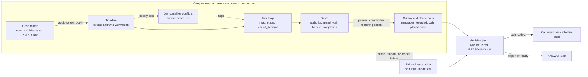

# lettable

Lettable works a property-management case the way a careful operations lead would. It reads the timeline — emails, calls, texts, holds, quotes and attachments — decides the next step, writes down why, and hands anything unsafe, unclear or unapproved to a person.

The model proposes. Plain code decides. A gate can only make an outcome stricter: wait, or escalate. A crash, a timeout or a bad answer still produces a handover, so a case never ends in silence.

Licence: Apache 2.0 ([LICENSE](LICENSE)). Submission metadata: [SUBMISSION.md](SUBMISSION.md).

| | |
|---|---|
| Track | Property Management |
| Entry point | `uv run python -m agent` |
| Default backend | `fake` — free, offline, no API key |
| Principle | The model proposes. Code decides. |
| A finished case | `decision.json`, `ANSWER.md`, `REASONING.md` |
| Design | [docs/design.md](docs/design.md) |

## 1. What we built

A command-line agent that reads a folder of cases and, for every case, writes a decision with its reasoning.

Each case folder holds `index.md`, `history.md`, and optionally `attachments/` and audio. The agent produces:

- the **next action** — wait, chase the landlord or provider, ask the tenant, provider or landlord, route a quote for approval, instruct the provider, send a reminder, close, or escalate to a person;
- the **messages and phone calls** that action needs, staged first and committed only when they match the final decision;
- a plain-language `ANSWER.md` (the decision, a structured case card, and any inconsistencies), a `REASONING.md` with the checks applied, and a machine-readable `decision.json`.

Around that loop: a replay harness that tests without an answer key, speech-to-text for audio, phone calls through ElevenLabs and Twilio, a Jev document-consistency check on the Reality Test, a local case workspace, and an exporter that lays results out as `ANSWERS/<n>/`.

| Action | The agent is doing |
|---|---|
| `WAIT` | Nothing is due yet. A follow-up is recorded. |
| `CHASE_LANDLORD` / `CHASE_PROVIDER` | An earlier request has gone unanswered long enough. |
| `ASK_TENANT` / `ASK_PROVIDER` / `ASK_LANDLORD` | A fact is missing, and that party can supply it. |
| `ROUTE_FOR_APPROVAL` | A quote or cost needs the landlord. |
| `INSTRUCT_PROVIDER` | The landlord has approved, and the provider has not been told to go ahead. |
| `SEND_REMINDER` | An appointment is booked. |
| `CLOSE` | The work, the invoice and the keys are settled. |
| `ESCALATE` | A person should decide. The handover says what is known, what is missing, what was tried, and two or three options. |

## 2. The operational problem it solves

A lettings desk spends the day on repairs, approvals and chasing. A case arrives across channels, often with a detail missing or two versions of the same fact. Most of the work is deciding what happens next and who is being waited on.

Two failures matter. A routine case sits unanswered. A risky one — a gas smell, spend the landlord has not approved, a document for the wrong property — gets handled without a person.

Lettable triages every case. It takes the safe next step and writes the message that goes with it. It escalates the rest with a handover a person can act on. Coverage is part of the design: every input folder gets an output.

## 3. Architecture

Full design, including gates, voice and the consistency check: [docs/design.md](docs/design.md). Field-by-field output: [docs/output-format.md](docs/output-format.md).



Four rules hold the system together.

**The model proposes. Code decides.** The model may read the case and stage an action. It cannot approve spend, invent a phone number, or send anything the gates refuse. A refusal comes back with a reason and a hint, so the model can choose a different step.

**A gate only tightens.** After `submit_decision`, `gates.apply` may replace the proposal with `WAIT` or `ESCALATE`. It never replaces a cautious proposal with a more active one. Hazard phrases, forcing red flags, a spend above the limit, a Jev escalate-tier conflict on the property, payee or bank details, and a low-confidence guess all escalate.

**A case always finishes.** Each case runs in its own process with a hard time limit. A crash, a hang, a model error or a malformed answer becomes a fallback escalation written by code, with no further model call. `summary.json` checks that outputs match inputs.

**Nothing leaves the machine until the final decision matches.** Tools only stage a message, approval request, follow-up, escalation, close or call. The matching action commits when the gates pass. Everything else is held for a person. A phone call is the one action that can leave the machine, and only when `--calls elevenlabs` is set.

The recorded overview, outcome, summary and status lines in `index.md` are stripped before the model sees the case, so a known ending cannot leak into the decision. Replay cuts the timeline at a chosen event and drops attachments.

Files are written to a temporary name and renamed. `decision.json` is written last. Its presence means the case finished.

| Module | Role |
|---|---|
| `agent/timeline.py` | Parse a case into events, attachments and a waiting state. Strip recorded endings. |
| `agent/details.py`, `agent/mismatches.py` | Build the case card and the conservative inconsistency checks. |
| `agent/loop.py`, `agent/tools.py`, `agent/policy.py`, `agent/chat.py` | The bounded tool loop, its tools, the operating policy, and the Claude and OpenAI clients. |
| `agent/gates.py`, `agent/evidence.py`, `agent/redflags.py` | Final checks: authority, spend, wait time, hazard, completion, red flags. |
| `agent/runner.py`, `agent/fallback.py` | Isolation, time limits, concurrency, resume, and escalation on failure. |
| `agent/report.py`, `agent/export.py`, `agent/files.py`, `agent/reality.py` | Output files, the `ANSWERS/` exporter, atomic writes, and the Reality Test runner. |
| `agent/replay.py` | Cut-and-compare check on finished cases. |
| `agent/stt.py`, `agent/voice.py`, `agent/calls.py`, `agent/channel.py`, `agent/oncall.py` | Speech-to-text, the dialer, call collection, the phone-channel policy, and the on-call briefing. |
| `agent/consistency.py` | Document consistency check: extract, then Jev scores the fields that still differ. On for the Reality Test. |
| `agent/ui.py`, `agent/ui_static/` | Local case workspace over a finished run. |

## 4. How to run it

**Prerequisites.** Python 3.9 or newer, and [uv](https://docs.astral.sh/uv/). The `fake` backend is free and offline and needs no API key.

**Install.** Clone the repo and sync the lockfile. The same two commands work on macOS, Linux and Windows.

```sh
git clone https://github.com/kulakovvad/lettable && cd lettable
uv sync
```

`uv sync` creates `.venv`, installs this project, and installs the versions recorded in `uv.lock`. Run the agent with `uv run` so the per-case worker uses that environment.

| Package | Required | Used for |
|---|---|---|
| `pypdf` | yes, `>=5` | PDF text for the code gates and the text preview. The exact version uv installs is in `uv.lock`. |
| `tzdata` | yes | UK local time for live-call hours. Windows has no system timezone database. macOS and Linux use this copy when theirs is missing. |
| `anthropic` | no | Only `--backend anthropic-single`, the older one-call path. Install with `uv sync --extra anthropic`. |

The Claude and OpenAI tool loops (`--backend claude`, `openai`, `auto`) use the Python standard library, so they do not need the `anthropic` extra. Tests use `unittest` from the standard library. With `--backend claude`, each PDF is also attached to the first message for Claude to read. A text preview can miss layout, stamps and scanned pages.

### Configure

Copy `.env.example` to `.env` and fill in what you need. `.env` is gitignored. Never commit keys. Paid features stay off unless asked for by name. Export the file before `uv run`.

```sh
set -a; . ./.env; set +a
```

```powershell
Get-Content .env | ForEach-Object {
  if ($_ -match '^\s*([A-Za-z_][A-Za-z0-9_]*)=(.*)$') { Set-Item -Path "env:$($Matches[1])" -Value $Matches[2] }
}
```

| Variable | Needed for | What it does |
|---|---|---|
| `ANTHROPIC_API_KEY` | `--backend claude` | Claude, the main model. |
| `ANTHROPIC_MODEL` | optional | Overrides the default model. Must be a model id the key can use. Leave empty otherwise. |
| `OPENAI_API_KEY` | `--backend openai` or `auto` | Optional fallback model. `OPENAI_MODEL` overrides its name. |
| `LETTABLE_BACKEND` | optional | Default backend: `fake` (default), `claude`, `openai`, `auto`. |
| `ELEVENLABS_API_KEY` | `--stt elevenlabs`, live calls | Speech-to-text and the phone-agent platform. |
| `ELEVENLABS_AGENT_ID` | live calls | The phone agent. Printed by `voice-setup --create-agent`. |
| `ELEVENLABS_PHONE_NUMBER_ID` | live calls | The imported Twilio number. Printed by `voice-setup --import-number`. |
| `LETTABLE_STT` | optional | `off` (default), `fake`, `elevenlabs`. |
| `LETTABLE_CALLS` | optional | `dry_run` (default: records calls, dials nothing) or `elevenlabs`. |
| `DEMO_CALL_NUMBER` | optional | A reminder of the phone used for a demo call. The code does not read it. |
| `TWILIO_ACCOUNT_SID`, `TWILIO_AUTH_TOKEN` | `voice-setup --import-number` | Read once, when importing a Twilio number into ElevenLabs. |
| `TYPESAFE_API_KEY` | consistency check | Jev document-similarity service. |
| `TYPESAFE_MODEL`, `TYPESAFE_BASE_URL` | optional | Override the Jev model name and URL. |
| `LETTABLE_ONCALL_NUMBER` | on-call briefing | Number the code phones when a case ends with a code-found hazard or priority P0. Empty means off. Never taken from a case or the model. |
| `LETTABLE_CALL_ALLOWLIST` | live calls | Comma-separated E.164 numbers a live call may dial. A live on-call briefing is dialled only when its number is on this list. When the list is set, other live calls off the list are held too. Empty leaves ordinary calls unchanged. Dry runs ignore it. |

### Run

```sh
uv run python -m agent run "<cases folder>" out/                      # fake backend: free, offline
uv run python -m agent run "<cases folder>" out/ --backend claude     # the tool loop with Claude
```

Useful options: `--timeout` (seconds per case), `--deadline` (whole run), `--concurrency`, `--resume`, `--now <ISO time>` (judge waits as of that time), `--config file.json` (override any value in `agent/config.py`).

Output shape: [docs/output-format.md](docs/output-format.md).

### Tests

```sh
uv run python -m unittest discover -s tests -t .
```

Offline. Failure injection for crashes, hangs and bad input is included. GitHub Actions runs the same suite on Ubuntu and Windows, on Python 3.9 and 3.12, after `uv sync --frozen`.

### Replay

Testing without an answer key. Cuts each finished case at a few points, shows the agent only the events up to that point, and compares its proposed action with what the agency actually did next. The "what happened next" label is a rough rule. Read the numbers as agreement, not accuracy.

```sh
uv run python -m agent replay "<cases folder>" out-replay/ --points 4
uv run python -m agent replay "<cases folder>" out-replay/ --points 2 --backend claude   # paid, capped at 30 points
```

### Voice

Details and safety rules: [docs/voice.md](docs/voice.md). The model may ask for a call. Code decides whether the phone is the right channel: two unanswered messages, a bounce, or an urgent hazard found by code.

```sh
uv run python -m agent run cases/ out/ --stt elevenlabs --calls dry_run   # transcribe audio; record calls, dial nothing
uv run python -m agent voice-setup --create-agent --yes                    # one-off: create the phone agent
uv run python -m agent voice-setup --import-number +1... --yes             # one-off: import a Twilio number
uv run python -m agent run cases/ out/ --backend claude --calls elevenlabs # places a real call when the agent decides to
uv run python -m agent calls collect out/ --backend elevenlabs             # bring finished calls back; re-run to use them
uv run python -m agent voice-test                                          # list simulated callers; add --live to run them
```

### Document consistency check

On for the Reality Test (`reality.json`). Off for a plain `agent run` unless a config file turns it on. It needs `TYPESAFE_API_KEY`. Without that key the Reality Test skips the check and the cases still run.

```sh
echo '{"consistency_check": true}' > jev.json
uv run python -m agent run cases/ out/ --backend claude --config jev.json
```

See [docs/design.md](docs/design.md#document-consistency-check).

### Case workspace

```sh
uv run python -m agent ui out/ --open      # http://127.0.0.1:8765/  (--port to change)
```

A local page over a finished run: the case list, what is known and what is not, the decision with its reasoning and evidence, and the model's tool calls. It reads `decision.json`, `summary.json` and `trace.jsonl` and never changes them. "Go with option N", "Take over case" and "Open as new case" record a person's choice in `<case>/review.json` ([docs/output-format.md](docs/output-format.md#review)). Nothing is sent anywhere. The server listens on 127.0.0.1 only, ignores symlinked case folders, and needs no extra dependencies. A case whose `decision.json` cannot be read is listed as `UNREADABLE`.

### Reality Test

Finds case folders at any depth, stages them, and writes `ANSWERS/<n>/`. Numeric folders are unpadded (`001` becomes `1`). A later pass retries fallbacks while the deadline allows and keeps decisions the model already finished.

```sh
uv run python -m agent doctor "<challenge folder>" --live     # keys, pypdf, writable output; --live makes one tiny model call
uv run python -m agent reality "<challenge folder>" --out ANSWERS --backend claude --deadline 1500
```

`--track` selects a track folder when the drop is split. The default track is Property Management. Speech-to-text defaults to ElevenLabs when the cases contain audio and the key is set. Calls default to `dry_run`. The Reality Test config turns on the document consistency check: when `TYPESAFE_API_KEY` is set, differing names, addresses, contacts and payment details are scored by Jev and tiered pass, flag or escalate before the tool loop.

### Export a finished run

```sh
uv run python -m agent export out/ --to ANSWERS
#   --force: overwrite folders from another run
#   --skip-incomplete: export the rest if one case lacks a file
```

Files are copied byte for byte. Case folders named with digits keep their number (`003` becomes `3`). The command writes nothing if the run has no finished case, two cases would share a number, or `ANSWERS/` already holds another run (override with `--force`).

## 5. Models, APIs and external services

| Service | Used for | Default |
|---|---|---|
| Anthropic Claude (Messages API). Model from `agent/config.py` (`claude-sonnet-5-5`), or `ANTHROPIC_MODEL`. | The tool loop. Main driver. | Off until `--backend claude`. The default backend is `fake`. |
| OpenAI. Model `gpt-5.4-mini` unless `OPENAI_MODEL` is set. | Optional fallback driver. | Off. |
| ElevenLabs Scribe (`scribe_v2`). | Speech-to-text for audio files. | Off (`--stt`). |
| ElevenLabs Agents. | The voice agent on a phone call. | Off. Calls are `dry_run`. |
| Twilio. | The telephone line the calls go through. | Off. |
| Jev, `api.typesafe.ai` (`jev-1.13.0`). | Whether names or addresses refer to the same entity. | On for the Reality Test. Off for a plain `agent run`. |

Everything else is the Python standard library, plus `pypdf` for PDF text and `tzdata` for UK local time where the operating system has no timezone database. The case text, and with `--backend claude` the PDF files themselves, are sent to the services you switch on. The public cases are synthetic. Third-party services remain subject to their own terms.

## 6. Important assumptions

- The public cases are the model for the hidden ones: markdown timelines, a landlord, a provider and a tenant, UK lettings.
- Case dates are synthetic, so waits are judged as of the latest event (`as_of = last_event`), not the wall clock. `--now` or `--as-of` change that.
- Thresholds are starting values: chase after 3 days, a GBP 300 approval limit (a placeholder), minimum model confidence 0.5. The agency has no authority of its own to approve spend. The GBP 300 figure is an escalation threshold, not an allowance.
- Messages, approval requests and closures are recorded in a local outbox. No email, CRM or ticketing system is connected. A phone call is the one action that leaves the machine, and only when `--calls elevenlabs` is set.
- Live calls are placed between 08:00 and 21:00 UK time, at most one per case and ten per run, to a number found in the case. The model never supplies the number.
- Hazard detection is a keyword check on the request, the attachments and the timeline, plus the model's judgement. Once a completion is confirmed, older events fall out of the scan except for the most recent few. When the code is unsure, the agent escalates.
- An email, a call, an invoice or a completion note is a claim. Code and policy require it to be checked against the property, the assigned provider, the approved amount and the agency before anyone is told the job is done.

## 7. Known limitations

- **Core logic is lightly tuned.** The Claude loop has been run on a small replay of the public cases, one real phone call to a team phone, and one real transcription. Prompts and thresholds are starting values. There is no run on a large held-out set.
- **Completed jobs often escalate.** About 15 of the 50 public cases show a completion the code recognises ([#11](https://github.com/kulakovvad/lettable/issues/11)). Providers that sign as a firm are missed, and wording such as "this one is done" is missed. Closing also needs invoice and key evidence ([#6](https://github.com/kulakovvad/lettable/issues/6)): "no keys held" can block a close that should proceed.
- **Chase timing is a fixed 3 days**, rather than the hold's own "(N days)" ([#7](https://github.com/kulakovvad/lettable/issues/7)).
- **The tenant update staged with `INSTRUCT_PROVIDER` is held**, although the prompt suggests sending it ([#8](https://github.com/kulakovvad/lettable/issues/8)).
- **The first landlord approval request cannot be sent** under `WAIT`. At the start of a repair the model drafts the request and submits `WAIT`. `route_for_approval` needs an amount already in the case, `chase` needs an earlier unanswered request, and under `WAIT` only the follow-up commits, so the request is held for review. See [docs/design.md](docs/design.md#replay-findings).
- **Voice.** Inbound calls, conversational text-to-speech replies and voicemail drops beyond the platform's fixed message are not handled. Calling hours and the run cap are checked in the runner and again in the dialer. Dry runs skip the hours check. `calls collect` rewrites `decision.json` without a lock, so two runs must not share an output folder.
- **Documents.** PDFs are read when `pypdf` is installed. Scanned files show as "content not available". Replay drops attachments. The consistency check adds a model call and a Jev call per case. The Reality Test turns it on. A small replay sample did not improve agreement with what the agency did next; the check still records a conflict so a person can see it.

## 8. What we would build next

1. Fix completion detection ([#11](https://github.com/kulakovvad/lettable/issues/11), [#6](https://github.com/kulakovvad/lettable/issues/6), [#7](https://github.com/kulakovvad/lettable/issues/7), [#8](https://github.com/kulakovvad/lettable/issues/8)) and measure it with replay on a held-out split.
2. A real action layer: send email and SMS, create tickets, and read the state back before retrying.
3. Send the first landlord approval request, instead of holding it under `WAIT`.
4. Tune thresholds and the policy on more cases, including a large held-out split.
5. Inbound calls and voicemail for tenants, with a human handover that keeps the call transcript.
6. Grow the local workspace into an operations dashboard: feed `review.json` choices back into the case, let a person ask about a case, and re-run a case from the page.

## Further reading

| Document | What it is |
|---|---|
| [docs/design.md](docs/design.md) | The case loop: actions, gates, isolation, voice, consistency, replay. |
| [docs/output-format.md](docs/output-format.md) | Every file and field a dashboard or a judge should read. |
| [docs/voice.md](docs/voice.md) | Audio in, phone calls out, and the rules that keep a live call narrow. |
| [skills/dwelly-rules/SKILL.md](skills/dwelly-rules/SKILL.md) | Hackathon rules used while building. |
