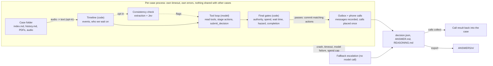

# lettable

An agent that works property-management cases. Each case is a timeline of emails, calls, texts and holds. The agent decides the next step, writes down why, and hands anything unsafe, unclear or unapproved to a person.

Licence: Apache 2.0 ([LICENSE](LICENSE)). Submission details: [SUBMISSION.md](SUBMISSION.md).

## 1. What we built

A command-line agent, `python3 -m agent`, that reads a folder of cases (`index.md`, `history.md`, optional `attachments/` and audio) and writes, for every case, a decision with its reasoning:

- the **next action**: wait, chase the landlord or provider, ask the tenant or provider, route a quote for approval, instruct the provider, send a reminder, close, or escalate to a person;
- the **messages and phone calls** that action needs (staged and gated, see below);
- a plain-language `ANSWER.md`, a `REASONING.md` with the checks applied, and a machine-readable `decision.json`.

Around the core loop: a replay harness to test without an answer key, speech-to-text for audio files, phone calls through ElevenLabs and Twilio, an opt-in document consistency check, and an exporter that lays results out as `ANSWERS/<n>/`.

## 2. The operational problem it solves

Lettings teams spend their day on repairs, approvals and chasing. Each case arrives through different channels with details missing or conflicting, and most of the work is deciding what to do next and who to wait for. Two things go wrong: routine cases sit unanswered, and risky ones (a gas smell, an unapproved spend, a document for the wrong property) get handled without a person.

The agent triages every case, takes safe next steps, and escalates the rest with what is known, what is missing, what was tried and two or three options. A case never ends without an output.

## 3. Architecture

The model proposes; plain code decides. Gates can only make an outcome stricter (wait or escalate), never looser. Full design: [docs/design.md](docs/design.md).



- **Isolation.** Every case runs in its own process with a hard time limit. A crash, hang, model error or malformed answer becomes a fallback escalation, so outputs always equal inputs (`summary.json` checks it).
- **Staged actions.** Tools only stage a message, approval request, follow-up, escalation, close or call. Staged actions commit only if they match the final action and the final gates pass; otherwise they are held for a person.
- **No leaks.** The recorded summary and outcome in `index.md` are never loaded, so a case's ending cannot reach the decision. Replay cuts a case at a point and drops attachments.
- **Atomic output.** Files are written to a temp file and renamed; `decision.json` is written last and marks a case as finished.

| Module | Role |
|---|---|
| `agent/timeline.py` | parse a case into events, attachments (with audio transcripts) and a waiting state |
| `agent/loop.py`, `agent/tools.py`, `agent/policy.py`, `agent/chat.py` | the bounded tool loop, its tools, the operating policy, the Claude/OpenAI clients |
| `agent/gates.py`, `agent/evidence.py` | code checks on the final decision |
| `agent/runner.py`, `agent/fallback.py` | isolation, time limits, concurrency, resume, escalation on failure |
| `agent/report.py`, `agent/export.py`, `agent/files.py` | output files, the `ANSWERS/` exporter, atomic writes |
| `agent/replay.py` | cut-and-compare check on finished cases |
| `agent/stt.py`, `agent/voice*.py`, `agent/calls.py` | speech-to-text, phone calls, collecting call results |
| `agent/consistency.py` | opt-in document consistency check |
| `agent/ui.py`, `agent/ui_static/` | local case workspace page over a run's results |

## 4. How to run it

**Prerequisites.** Python 3.9 or newer. The default setup has no dependencies and needs no keys (the `fake` backend is free and offline).

**Install.** `git clone https://github.com/kulakovvad/lettable && cd lettable`. Optional: `pip install pypdf` to read PDF attachments. The model clients use the standard library, so no SDK is needed.

**Configure.** `cp .env.example .env`, fill in what you need, and export it (`set -a; . ./.env; set +a`). `.env` is gitignored; never commit keys. Paid features are off unless asked for by name.

| Variable | Needed for | What it does |
|---|---|---|
| `ANTHROPIC_API_KEY` | `--backend claude` | Claude (main model) |
| `ANTHROPIC_MODEL` | optional | overrides the default model; must be a model id your key can use, otherwise leave empty |
| `OPENAI_API_KEY` | `--backend openai` or `auto` | optional fallback model (`OPENAI_MODEL` overrides its name) |
| `LETTABLE_BACKEND` | optional | default backend: `fake` (default), `claude`, `openai`, `auto` |
| `ELEVENLABS_API_KEY` | `--stt elevenlabs`, live calls | speech-to-text and the phone agent platform |
| `ELEVENLABS_AGENT_ID` | live calls | the phone agent (printed by `voice-setup --create-agent`) |
| `ELEVENLABS_PHONE_NUMBER_ID` | live calls | the imported Twilio number (printed by `voice-setup --import-number`) |
| `LETTABLE_STT` | optional | `off` (default), `fake`, `elevenlabs` |
| `LETTABLE_CALLS` | optional | `dry_run` (default: records calls, dials nothing) or `elevenlabs` |
| `DEMO_CALL_NUMBER` | optional | a reminder of the phone you use for a demo call; the code does not read it |
| `TWILIO_ACCOUNT_SID`, `TWILIO_AUTH_TOKEN` | `voice-setup --import-number` | read once when importing a Twilio number into ElevenLabs |
| `TYPESAFE_API_KEY` | consistency check | Jev document-similarity service |
| `TYPESAFE_MODEL`, `TYPESAFE_BASE_URL` | optional | override Jev model name and URL |
| `LETTABLE_ONCALL_NUMBER` | on-call briefing | number the code phones when a case ends with a code-found hazard or priority P0; empty means off. Never taken from a case or the model |
| `LETTABLE_CALL_ALLOWLIST` | live calls | comma-separated E.164 numbers a live call may dial. A live on-call briefing is dialled only if its number is on this list; when the list is set, other live calls off the list are held too. Empty leaves ordinary calls unchanged. Dry runs ignore it |

**Run.**

```
python3 -m agent run "<cases folder>" out/                      # fake backend: free, offline
python3 -m agent run "<cases folder>" out/ --backend claude     # the tool loop with Claude
```

Each case folder holds `index.md`, `history.md` and optional `attachments/`. Useful options: `--timeout` (seconds per case), `--deadline` (whole run), `--concurrency`, `--resume`, `--now <ISO time>` (judge waits as of that time), `--config file.json` (override any value in `agent/config.py`). Output format: [docs/output-format.md](docs/output-format.md).

**Tests.** `python3 -m unittest discover -s tests -t .` (offline; failure injection for crashes, hangs and bad input included).

**Replay (testing without an answer key).**

```
python3 -m agent replay "<cases folder>" out-replay/ --points 4
python3 -m agent replay "<cases folder>" out-replay/ --points 2 --backend claude   # paid, capped at 30 points
```

Cuts each finished case at a few points, shows the agent only the events up to that point and compares its proposed action with what the agency actually did next. The "what happened next" label is a rough rule, so read the numbers as agreement, not accuracy.

**Voice.** Details and safety rules: [docs/voice.md](docs/voice.md).

```
python3 -m agent run cases/ out/ --stt elevenlabs --calls dry_run   # transcribe audio; record calls, dial nothing
python3 -m agent voice-setup --create-agent --yes                    # one-off: create the phone agent
python3 -m agent voice-setup --import-number +1... --yes             # one-off: import a Twilio number
python3 -m agent run cases/ out/ --backend claude --calls elevenlabs # places a real call when the agent decides to
python3 -m agent calls collect out/ --backend elevenlabs             # bring finished calls back; re-run to use them
```

**Document consistency check (opt-in).** `echo '{"consistency_check": true}' > jev.json` then add `--config jev.json` and set `TYPESAFE_API_KEY`. See [docs/design.md](docs/design.md#document-consistency-check-opt-in).

**UI (case workspace).**

```
python3 -m agent ui out/ --open      # http://127.0.0.1:8765/  (--port to change)
```

A local page over a finished run: the case list, the case info and what is not known, the decision with its reasoning and evidence refs, and the model's tool calls. It reads `decision.json`, `summary.json` and `trace.jsonl` and never changes them. "Go with option N", "Take over case" and "Open as new case" record a person's choice in `<case>/review.json` ([docs/output-format.md](docs/output-format.md#review)); nothing is sent anywhere. The server listens on 127.0.0.1 only, ignores symlinked case folders and needs no dependencies. A case whose `decision.json` cannot be read is listed as `UNREADABLE` rather than hidden.

**Export the results for submission.**

```
python3 -m agent export out/ --to ANSWERS    # ANSWERS/<n>/ANSWER.md, REASONING.md, decision.json, ANSWERS/index.json, ANSWERS/_run/
#   --force: overwrite folders from another run   --skip-incomplete: export the rest if one case lacks a file
```

Files are copied byte for byte and never edited. Case folders named with digits keep their number (`003` becomes `3`). The command refuses, and writes nothing, if the run has no finished case, two cases would share a number, or `ANSWERS/` holds another run's results (override with `--force`).

## 5. Models, APIs and external services

| Service | Used for | Default |
|---|---|---|
| Anthropic Claude (Messages API), model from `agent/config.py` (`claude-sonnet-5-5`) or `ANTHROPIC_MODEL` | the tool loop; main driver | off (`fake` backend until `--backend claude`) |
| OpenAI (model `gpt-5.4-mini` unless `OPENAI_MODEL`) | optional fallback driver | off |
| ElevenLabs Scribe (`scribe_v2`) | speech-to-text for audio files | off (`--stt`) |
| ElevenLabs Agents platform | the voice agent on a phone call | off (calls are `dry_run`) |
| Twilio | the telephone line the calls go through | off |
| Jev, `api.typesafe.ai` (`jev-1.13.0`) | scoring whether names or addresses refer to the same entity | off (`consistency_check`) |

Everything else is the Python standard library. Optional: `pypdf` for PDF text. The case text is sent to the services you switch on; the public cases are synthetic. Third-party services remain subject to their own terms.

Case images are sent to Claude with the first message when `--backend claude` is on.

## 6. Important assumptions

- The public cases are the model for the hidden ones: markdown timelines, a landlord, a provider and a tenant, UK lettings.
- Case dates are synthetic, so by default waits are judged as of the latest event (`as_of = last_event`), not the wall clock. `--now` or `--as-of` change that.
- Thresholds are starting values, not tuned: chase after 3 days, a GBP 300 approval limit (a placeholder), minimum model confidence 0.5. The agency has no authority of its own to approve spend.
- Actions are recorded in a local outbox; no email, CRM or ticketing system is connected. Phone calls are the one action that leaves the machine, and only when `--calls elevenlabs` is set.
- Live calls are only placed between 08:00 and 21:00 UK time, at most one per case and 10 per run, to a number found in the case.
- Hazard detection is a keyword check on recent events and attachments plus the model's judgement; when unsure the agent escalates.

## 7. Known limitations

- **Core logic only lightly tuned.** The Claude loop has been run on a small replay of the public cases, one real phone call to a team phone and one real transcription. Prompts and thresholds are not tuned beyond that, and there is no run on a large held-out set.
- **Completed jobs often escalate.** Only about 15 of the 50 public cases show a completion the code recognises ([#11](https://github.com/kulakovvad/lettable/issues/11)): providers that sign as a firm are not recognised as providers, and wording such as "this one is done" is missed. Closing also needs invoice and key evidence ([#6](https://github.com/kulakovvad/lettable/issues/6): "no keys held" wrongly blocks a close).
- **Chase timing is a fixed 3 days** instead of the hold's own "(N days)" ([#7](https://github.com/kulakovvad/lettable/issues/7)).
- **The tenant update with `INSTRUCT_PROVIDER` is held**, although the prompt suggests sending it ([#8](https://github.com/kulakovvad/lettable/issues/8)).
- **The first landlord approval request cannot be sent** under `WAIT` (see [docs/design.md](docs/design.md#replay-findings-dev-split-1200-run)).
- **Voice:** inbound calls, text-to-speech replies and voicemail drops are not handled; calling hours and the run cap are checked in the runner and again in the dialer; dry runs skip the hours check; `calls collect` rewrites `decision.json` without a lock.
- PDFs are read only when `pypdf` is installed; scanned files show as "content not available". Replay drops attachments.
- The consistency check adds a model call and an external service per case, and on a small sample did not improve agreement, so it stays off.

## 8. What we would build next

1. Fix completion detection (#11, #6, #7, #8) and measure it with replay on a held-out split.
2. A real action layer: send email and SMS, create tickets, and read the state back before retrying.
3. Send the first landlord approval request instead of holding it.
4. Tune thresholds and the policy on more cases, including a large held-out split.
5. Inbound calls and voicemail for tenants, with a human handover that keeps the call transcript.
6. Grow the local UI into a dashboard for the operations team: feed `review.json` choices back into the case, ask the agent about a case, and re-run a case from the page.
