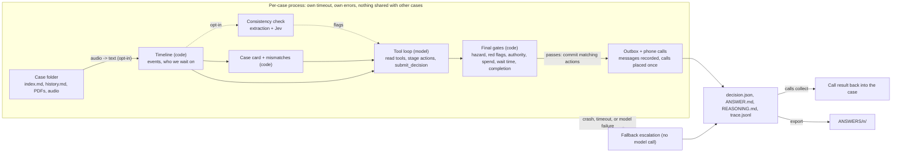

# lettable

An agent that works property-management repair cases. Each case is a timeline of emails, calls, texts and holds. The agent decides the next step, writes down why, and hands anything unsafe, unclear or unapproved to a person. The model proposes; plain code decides.

[](https://github.com/kulakovvad/lettable/actions/workflows/test.yml)

Licence: Apache 2.0 ([LICENSE](LICENSE)). Design: [docs/design.md](docs/design.md). Output format: [docs/output-format.md](docs/output-format.md). Voice: [docs/voice.md](docs/voice.md). Submission details: [SUBMISSION.md](SUBMISSION.md).

## Quick start

```sh
git clone https://github.com/kulakovvad/lettable && cd lettable
uv sync
uv run python -m agent run "<cases folder>" out/        # offline, free, no API key
uv run python -m agent ui out/ --open                   # look at the results
```

For the real model, see [Production runbook](#production-runbook).

## 1. What we built

A command-line agent, `uv run python -m agent`, that reads a folder of cases (`index.md`, `history.md`, optional `attachments/` and audio) and writes, for every case, a decision with its reasoning:

- the **next action**: wait, chase the landlord or provider, ask the tenant, landlord or provider, route a quote for approval, instruct the provider, send a reminder, close, or escalate to a person;
- the **messages and phone calls** that action needs, staged during the run and committed only if the code gates pass;
- a plain-language `ANSWER.md` (decision, a structured case card with a source for every value, and any inconsistencies found in the case), a `REASONING.md` with the checks applied, a `trace.jsonl` of every model turn and gate verdict, and a machine-readable `decision.json`.

Around the core loop: preflight checks, a batch command for folders of unknown layout, a replay harness and grader to test without an answer key, speech-to-text for audio files, phone calls through ElevenLabs and Twilio with a code-driven on-call briefing for urgent cases, an opt-in document consistency check, a local case workspace UI, and an exporter that lays results out as `ANSWERS/<n>/`.

## 2. The operational problem it solves

Lettings teams spend their day on repairs, approvals and chasing. Each case arrives through different channels with details missing or conflicting, and most of the work is deciding what to do next and who to wait for. Two things go wrong: routine cases sit unanswered, and risky ones (a gas smell, an unapproved spend, new bank details, a document for the wrong property) get handled without a person.

The agent triages every case, takes safe next steps, and escalates the rest with what is known, what is missing, what was tried, a route and priority, and two or three options. A case never ends without an output.

## 3. Architecture

The model proposes; plain code decides. Gates can only make an outcome stricter (wait or escalate), never looser. Full design, gate list and failure handling: [docs/design.md](docs/design.md).



- **Isolation.** Every case runs in its own process with a hard time limit. A crash, hang, model error or malformed answer becomes a fallback escalation, so outputs always equal inputs (`summary.json` reports `reconciled`).
- **Staged actions.** Tools only stage a message, approval request, follow-up, escalation, close or call. Staged actions commit only if they match the final action and the final gates pass; otherwise they are held for a person.
- **Safety in code.** Hazards (gas, CO, flooding, exposed wiring, fire, threats), payment redirection, legal matters, vulnerable occupants and abuse force an escalation regardless of what the model proposes. Spend above the approval limit needs a landlord approval in the case.
- **No leaks.** The recorded summary and outcome in `index.md` are never loaded, so a case's ending cannot reach the decision. Replay cuts a case at a point and drops attachments.
- **Atomic output.** Files are written to a temp file and renamed; `decision.json` is written last and marks a case as finished.

| Module | Role |
|---|---|
| `agent/timeline.py` | parse a case into events, attachments (with audio transcripts) and a waiting state |
| `agent/details.py`, `agent/mismatches.py` | the case card with a source for every value; code detectors for conflicting addresses, amounts, completion and contacts |
| `agent/loop.py`, `agent/tools.py`, `agent/policy.py`, `agent/chat.py` | the bounded tool loop, its tools, the operating policy, the Claude/OpenAI clients |
| `agent/gates.py`, `agent/evidence.py`, `agent/redflags.py`, `agent/handover.py` | code checks on the final decision; the escalation packet |
| `agent/runner.py`, `agent/fallback.py` | isolation, time limits, concurrency, resume, escalation on failure |
| `agent/report.py`, `agent/export.py`, `agent/files.py` | output files, the `ANSWERS/` exporter, atomic writes |
| `agent/reality.py`, `agent/doctor.py` | batch run over a folder of unknown layout; preflight checks |
| `agent/replay.py`, `agent/grade.py` | cut-and-compare check on finished cases; grading against rubrics |
| `agent/stt.py`, `agent/voice*.py`, `agent/calls.py`, `agent/channel.py`, `agent/oncall.py` | speech-to-text, phone calls and when they are allowed, the on-call briefing |
| `agent/consistency.py` | opt-in document consistency check |
| `agent/ui.py`, `agent/ui_static/` | local case workspace page over a run's results |

## 4. How to run it

**Prerequisites.** Python 3.9 or newer, and [uv](https://docs.astral.sh/uv/). The `fake` backend is free and offline and needs no API key.

**Install.** The same commands work on macOS, Linux and Windows:

```sh
git clone https://github.com/kulakovvad/lettable && cd lettable
uv sync
```

`uv sync` creates `.venv`, installs this project, and installs the versions recorded in `uv.lock`. For a reproducible deploy use `uv sync --frozen`, which fails instead of updating the lockfile. Run the agent with `uv run` so the per-case worker uses the same environment.

| Package | Required | Used for |
|---|---|---|
| `pypdf` | yes, `>=5` | PDF text for the code gates and the text preview. The exact version uv installs is in `uv.lock` |
| `tzdata` | yes | UK local time for live-call hours. Windows has no system timezone database; macOS and Linux use this copy if theirs is missing |
| `anthropic` | no | only `--backend anthropic-single`, the older one-call path. Install with `uv sync --extra anthropic` |

The Claude and OpenAI tool loops (`--backend claude`, `openai`, `auto`) use the Python standard library, so they do not need the `anthropic` extra. With `--backend claude`, each PDF and image is also attached to the first message for Claude to read; a text preview can miss layout, stamps and scanned pages.

### Configure

Copy `.env.example` to `.env` and fill in what you need. `.env` is gitignored; never commit keys. Paid and outbound features are off unless asked for by name, and a key in the environment does not switch on spend by itself. Export the file before `uv run`:

```sh
set -a; . ./.env; set +a
```

```powershell
Get-Content .env | ForEach-Object {
  if ($_ -match '^\s*([A-Za-z_][A-Za-z0-9_]*)=(.*)$') { Set-Item -Path "env:$($Matches[1])" -Value $Matches[2] }
}
```

| Variable | Needed for | What it does |
|---|---|---|
| `ANTHROPIC_API_KEY` | `--backend claude` | Claude (main model) |
| `ANTHROPIC_MODEL` | optional | overrides the default model; must be a model id your key can use, otherwise leave empty |
| `OPENAI_API_KEY` | `--backend openai` or `auto` | optional fallback model (`OPENAI_MODEL` overrides its name) |
| `LETTABLE_BACKEND` | optional | default backend: `fake` (default), `claude`, `openai`, `auto` |
| `ELEVENLABS_API_KEY` | `--stt elevenlabs`, live calls | speech-to-text and the phone agent platform |
| `ELEVENLABS_AGENT_ID` | live calls | the phone agent (printed by `voice-setup --create-agent`) |
| `ELEVENLABS_PHONE_NUMBER_ID` | live calls | the imported Twilio number (printed by `voice-setup --import-number`) |
| `LETTABLE_STT` | optional | `off` (default), `fake`, `elevenlabs` |
| `LETTABLE_CALLS` | optional | `dry_run` (default: records calls, dials nothing) or `elevenlabs` |
| `DEMO_CALL_NUMBER` | optional | a reminder of the phone you use for a test call; the code does not read it |
| `TWILIO_ACCOUNT_SID`, `TWILIO_AUTH_TOKEN` | `voice-setup --import-number` | read once when importing a Twilio number into ElevenLabs |
| `TYPESAFE_API_KEY` | consistency check | Jev document-similarity service |
| `TYPESAFE_MODEL`, `TYPESAFE_BASE_URL` | optional | override Jev model name and URL |
| `LETTABLE_ONCALL_NUMBER` | on-call briefing | number the code phones when a case ends with a code-found hazard or priority P0; empty means off. Never taken from a case or the model |
| `LETTABLE_CALL_ALLOWLIST` | live calls | comma-separated E.164 numbers a live call may dial. A live on-call briefing is dialled only if its number is on this list; when the list is set, other live calls off the list are held too. Empty leaves ordinary calls unchanged. Dry runs ignore it |

Thresholds and limits live in `agent/config.py`. Override any of them per run with `--config file.json` instead of editing code; see [Tuning](#tuning).

### Commands

| Command | What it does | Leaves the machine |
|---|---|---|
| `run <cases> <out>` | decide every case folder in `<cases>` | only with a paid backend, `--stt elevenlabs` or `--calls elevenlabs` |
| `reality <dir> --out ANSWERS` | find cases at any depth, run them, retry fallbacks while the deadline allows, export `ANSWERS/<n>/`. Reads `reality.json` by default; backend defaults to `claude` | yes |
| `doctor [<dir>] [--live]` | preflight: keys present (never printed), `pypdf`, output writable, cases found; `--live` makes one tiny model call | only with `--live` |
| `replay <cases> <out> --points N` | cut finished cases and compare with what happened next | only with a paid backend (capped at 30 points) |
| `grade <out> <eval>` | check decisions against `<id>.expected.json` rubrics; `--judge` adds an advisory model score | only with `--judge` |
| `export <out> --to ANSWERS` | copy results byte for byte into `ANSWERS/<n>/` | no |
| `ui <out> [--open]` | local case workspace on 127.0.0.1 | no |
| `calls collect <out>` | bring finished phone calls back into `decision.json` | with `--backend elevenlabs` |
| `voice-setup`, `voice-test` | create or update the phone agent, import a number, simulate callers | only with `--yes` / `--live` |

Useful `run` options: `--backend`, `--timeout` (seconds per case), `--deadline` (whole run), `--concurrency`, `--resume` (redo only fallbacks), `--now <ISO time>` and `--as-of` (when waits are judged), `--config file.json`, `--stt`, `--calls`.

### Production runbook

```sh
set -a; . ./.env; set +a
uv sync --frozen
uv run python -m agent doctor "<cases>" --backend claude --live          # fix every fail before spending
uv run python -m agent run "<cases>" out/ --backend claude --config prod.json --as-of now
cat out/summary.json                                                     # "reconciled": true, check "fallbacks"
uv run python -m agent run "<cases>" out/ --backend claude --config prod.json --as-of now --resume   # redo fallbacks only
uv run python -m agent ui out/ --open                                    # a person reviews escalations
```

- Try a small subset first; do not run a paid backend on a whole set "to see".
- Use `--as-of now` (or `--now <ISO time>`) on live cases so waits are measured against the clock. Without it, waits are judged as of each case's latest event.
- Keep `--calls dry_run` until `LETTABLE_CALL_ALLOWLIST` is set and `voice-test --live` passes. Live calls are limited to 08:00 to 21:00 UK time, one per case and ten per run.
- `calls collect` rewrites `decision.json` without a lock; do not run it while a run is writing to the same folder.
- For an unknown folder layout, `reality` wraps the same steps: `uv run python -m agent reality "<dir>" --out ANSWERS --deadline 3000`.

### Tuning

Write only the values you change into a JSON file and pass it with `--config`. The ones an agency should set before go-live:

| Key | Default | Meaning |
|---|---|---|
| `approval_limit_gbp` | `300.0` | spend above this needs a landlord approval in the case. **Placeholder**; set your own |
| `chase_after_days` | `3.0` | how long to wait on a party before chasing |
| `min_confidence` | `0.5` | below this the decision escalates, except a verified wait |
| `call_after_unanswered`, `call_after_hours` | `2`, `24.0` | when writing has failed enough for a phone call |
| `call_hours` | `[8, 21]` | UK local hours for live calls |
| `max_calls_per_case`, `max_calls_per_run` | `1`, `10` | live call caps |
| `case_timeout_s`, `concurrency`, `max_retries` | `240`, `4`, `4` | time per case, parallel cases, model retries |
| `loop_max_steps` | `12` | model turns per case |
| `model`, `openai_model` | `claude-sonnet-5-5`, `gpt-5.4-mini` | overridden by `ANTHROPIC_MODEL` / `OPENAI_MODEL` |
| `hazard_patterns`, `hazard_window` | see `agent/config.py`, `5` | phrases that force an escalation, and how many recent events are scanned |
| `consistency_check` | `false` | the opt-in Jev check |

### Tests

```sh
uv run python -m unittest discover -s tests -t .
```

About 490 tests, offline and free, including failure injection for crashes, hangs, corrupt files and model errors. GitHub Actions runs them on Ubuntu and Windows with Python 3.9 and 3.12 after `uv sync --frozen`.

### Replay (testing without an answer key)

```sh
uv run python -m agent replay "<cases folder>" out-replay/ --points 4
uv run python -m agent replay "<cases folder>" out-replay/ --points 2 --backend claude   # paid, capped at 30 points
```

Cuts each finished case at a few points, shows the agent only the events up to that point and compares its proposed action with what the agency actually did next. The "what happened next" label is a rough rule, so read the numbers as agreement, not accuracy.

### Voice

Details and safety rules: [docs/voice.md](docs/voice.md). The model asks for a call, but code decides whether the phone is the right channel (two unanswered messages, a bounce, or an urgent hazard).

```sh
uv run python -m agent run cases/ out/ --stt elevenlabs --calls dry_run   # transcribe audio; record calls, dial nothing
uv run python -m agent voice-setup --create-agent --yes                    # one-off: create the phone agent
uv run python -m agent voice-setup --import-number +1... --yes             # one-off: import a Twilio number
uv run python -m agent voice-test --live                                   # simulated callers, no phone
uv run python -m agent run cases/ out/ --backend claude --calls elevenlabs # places a real call when allowed
uv run python -m agent calls collect out/ --backend elevenlabs             # bring finished calls back; re-run to use them
```

### Document consistency check (opt-in)

`echo '{"consistency_check": true}' > jev.json`, then add `--config jev.json` and set `TYPESAFE_API_KEY`. See [docs/design.md](docs/design.md#5-document-consistency-check-opt-in).

### UI (case workspace)

```sh
uv run python -m agent ui out/ --open      # http://127.0.0.1:8765/  (--port to change)
```

A local page over a finished run: the case list, the case info and what is not known, the decision with its reasoning and evidence refs, call transcripts, and the model's tool calls. It reads `decision.json`, `summary.json` and `trace.jsonl` and never changes them. "Go with option N", "Take over case" and "Open as new case" record a person's choice in `<case>/review.json` ([docs/output-format.md](docs/output-format.md#review)); nothing is sent anywhere. The server listens on 127.0.0.1 only, ignores symlinked case folders and needs no dependencies. A case whose `decision.json` cannot be read is listed as `UNREADABLE` rather than hidden.

### Export

```sh
uv run python -m agent export out/ --to ANSWERS    # ANSWERS/<n>/ANSWER.md, REASONING.md, decision.json, ANSWERS/index.json, ANSWERS/_run/
#   --force: overwrite folders from another run   --skip-incomplete: export the rest if one case lacks a file
```

Files are copied byte for byte and never edited. Case folders named with digits keep their number (`003` becomes `3`). The command refuses, and writes nothing, if the run has no finished case, two cases would share a number, or `ANSWERS/` holds another run's results (override with `--force`).

### Troubleshooting

| Symptom | Likely cause |
|---|---|
| Every case is a fallback escalation | wrong key or model name; run `doctor --live` |
| Fallbacks with cause `timeout` | raise `case_timeout_s` or lower `concurrency` if rate-limited |
| Nothing ever chased | waits judged as of the latest event; pass `--as-of now` on live cases |
| A call was recorded but not placed | `--calls dry_run`, outside calling hours, cap reached, or number not on the allow-list |
| Attachment shows "content not available" | scanned PDF or `pypdf` missing; use `--backend claude` so Claude reads the file |

## 5. Models, APIs and external services

| Service | Used for | Default |
|---|---|---|
| Anthropic Claude (Messages API), model from `agent/config.py` (`claude-sonnet-5-5`) or `ANTHROPIC_MODEL` | the tool loop; main driver | off (`fake` backend until `--backend claude`) |
| OpenAI (model `gpt-5.4-mini` unless `OPENAI_MODEL`) | optional fallback driver | off |
| ElevenLabs Scribe (`scribe_v2`) | speech-to-text for audio files | off (`--stt`) |
| ElevenLabs Agents platform | the voice agent on a phone call | off (calls are `dry_run`) |
| Twilio | the telephone line the calls go through | off |
| Jev, `api.typesafe.ai` (`jev-1.13.0`) | scoring whether names or addresses refer to the same entity | off (`consistency_check`) |

Everything else is the Python standard library. `pypdf` reads PDF text and `tzdata` supplies UK local time where the operating system has no timezone database. Third-party services remain subject to their own terms.

### Security and data handling

- Case text is sent to the model provider you switch on; with `--backend claude` the PDF and image files are sent too. Audio goes to ElevenLabs only with `--stt elevenlabs`; field values go to Jev only with the consistency check on. Nothing else leaves the machine.
- Secrets come from the environment only and are never printed; `doctor` reports presence, not values.
- Phone numbers dialled come from the case or, for the on-call briefing, from configuration; never from model output alone. Set `LETTABLE_CALL_ALLOWLIST` for any live calling.
- Output folders (`out/`, `runs/`, `results/`) and `.cache/stt` are gitignored. They contain tenant personal data; store and delete them under your retention policy.
- The UI binds to 127.0.0.1 only. Do not expose it on a network without adding authentication.

## 6. Important assumptions

- Cases look like the public set: markdown timelines, a landlord, a provider and a tenant, UK lettings.
- By default waits are judged as of the latest event (`as_of = last_event`), not the wall clock, because sample case dates are synthetic. Live use should pass `--now` or `--as-of now`.
- Thresholds are starting values, not tuned: chase after 3 days, a GBP 300 approval limit (a placeholder), minimum model confidence 0.5. The agency has no authority of its own to approve spend.
- Actions are recorded in a local outbox; no email, CRM or ticketing system is connected. Phone calls are the one action that leaves the machine, and only when `--calls elevenlabs` is set.
- Live calls are only placed between 08:00 and 21:00 UK time, at most one per case and 10 per run, to a number found in the case (or the configured on-call number).
- Hazard detection is a pattern check on recent events and attachments plus the model's judgement; when unsure the agent escalates.

## 7. Known limitations

- **Lightly tuned.** The Claude loop has been run on a small replay of the public cases, one real phone call to a team phone and one real transcription. Prompts and thresholds are not tuned beyond that, and there is no run on a large held-out set.
- **Completed jobs often escalate.** Providers that sign as a firm are not recognised as providers, and wording such as "this one is done" is missed ([#11](https://github.com/kulakovvad/lettable/issues/11)). Closing also needs invoice and key evidence, and "no keys held" wrongly blocks a close ([#6](https://github.com/kulakovvad/lettable/issues/6)).
- **Chase timing is a fixed 3 days** instead of the hold's own "(N days)" ([#7](https://github.com/kulakovvad/lettable/issues/7)).
- **The tenant update with `INSTRUCT_PROVIDER` is held**, although the policy suggests sending it ([#8](https://github.com/kulakovvad/lettable/issues/8)).
- **The first landlord approval request cannot be sent** under `WAIT` (see [docs/design.md](docs/design.md#10-known-limitations)).
- **No outbound messaging.** Emails, texts, approval requests and closures are recorded, not sent.
- **Voice:** inbound calls, text-to-speech replies and voicemail drops are not handled; dry runs skip the calling-hours check; `calls collect` rewrites `decision.json` without a lock.
- PDFs are read only when `pypdf` is installed; scanned files show as "content not available" unless Claude reads the file. Replay drops attachments.
- The consistency check adds a model call and an external service per case, and on a small sample did not improve agreement, so it stays off.

## 8. What we would build next

The go-live checklist is in [docs/design.md](docs/design.md#11-before-go-live). In order:

1. Fix completion detection and chase timing (#11, #6, #7, #8) and measure it with replay on the holdout split.
2. A real action layer: send email and SMS, create tickets, and read the state back before retrying, reusing the idempotency keys the outbox already records.
3. Send the first landlord approval request instead of holding it.
4. Agency-specific configuration (approval limit, chase timing, calling hours) and review of the legal and safety templates by a UK lettings expert.
5. Tune thresholds and the policy on more cases, including a large held-out split.
6. Inbound calls and voicemail for tenants, with a human handover that keeps the call transcript.
7. Grow the local UI into an authenticated dashboard for the operations team: feed `review.json` choices back into the case, ask the agent about a case, and re-run a case from the page.
