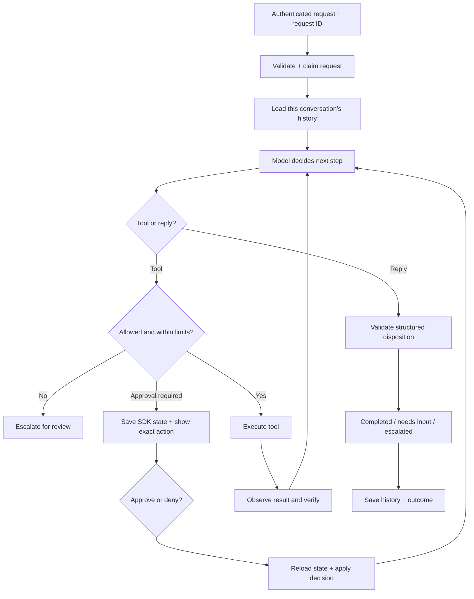

# Lettable agent loop

## Mental model: a worker with a supervisor

The model is the worker. It interprets intent, chooses the next tool, and explains results. Application code is the supervisor. It determines what tools exist, enforces access and approval, keeps records, and stops unproductive work. A prompt helps the worker make good choices; permissions and operational guarantees belong in code.

There are two loops. The inner SDK loop performs model → tool → observation → model until there is a reply or an approval interruption. The outer product conversation persists across user turns. A clarification ends one run with `needs_input`; the user's answer starts another run with the saved history. An approval resumes the existing SDK run with exactly the pending call IDs.

“Verify” must mean evidence from a service, not another model saying it looks fine. For future writes, the adapter should return a durable receipt and the agent should read the resulting service state. `completed` currently validates the response's shape; it is not proof a business task succeeded. Domain-specific completion checks are still required.

## Prompt format and Reality Test coverage

The operational prompt in `lettable/agent.py` uses headed plain text: role, authority, evidence, risk, action/verification, recovery and final disposition. JSON is useful for machine-validated inputs and outputs; wrapping natural-language instructions in JSON adds escaping without enforcing their meaning. `Reply` already supplies the strict output schema through the SDK, including structured case triage. See [the integration and priority policy](integration-policy.md) for tool contracts and queue integration.

Pass only trusted application-owned business policies to `create_agent(instructions=...)`. Put user requests, supplied case documents and retrieved messages in their appropriate input/tool channels, never in this policy argument. Integrations must specify authority, approval requirements, emergency routes, completion evidence and relevant business thresholds; the prompt does not invent them.

The prompt covers ambiguous identities, conflicting/stale records, noisy context, multiple dependent tasks, changed intent, urgent hazards, denied approval/access, unavailable tools, duplicate actions, uncertain writes, partial success and malicious document instructions. It requires a concise evidence-based handover when safe autonomous resolution is impossible. An escalation message alone does not create a service ticket or notify a person.

This is a general decision policy, not a guarantee of success on unseen cases. The offline suite checks runtime mechanics, not the model's judgement. The three opt-in live cases remain a small synthetic baseline. Before claiming Reality Test readiness, evaluate the actual supplied tools and business policies against these exception cases and inspect observed actions and service state. No real property-management tools are currently configured by default.

## What exists today

- `lettable/agent.py`: one agent, structured replies, serial tool preference, bounded output per model response. No business tools supplied by default.
- `lettable/runtime.py`: SDK runner wrapper, input validation, wall-clock deadline per execution segment, turn/token/tool/repetition limits, safe failure dispositions, cancellation, approval resume and expiry. Limits and hashes persist across approval pauses.
- `lettable/store.py`: SQLite conversation history, request deduplication, one active run per scoped conversation, persisted SDK approval snapshots, atomic resume claim.
- `lettable/tools.py`: bounded exponential backoff with jitter for explicitly replay-safe reads. Whole agent runs are never retried automatically.
- Offline regression suite exercises real SDK calls with scripted Responses items. Live eval suite is separate and explicitly opt-in.

Only authenticated server code should supply `principal`; never trust a principal submitted by a browser or generated by the model. Each tool receives the trusted principal in `RunContextWrapper.context`, and each future service adapter must enforce record-level authorization. Conversation separation alone does not authorize access to service records.

## What happens when something goes wrong

Missing facts: ask a concise question, retain history, wait for the next turn.

A replay-safe read fails temporarily: retry that read a bounded number of times. Permanent errors propagate. Provider transport retries belong inside the model request configuration, not around a whole workflow that may have performed writes.

An action requires approval: persist SDK state and expose the exact tool and arguments. The server accepts explicit booleans for the pending call IDs only. Approval is single-use and expires; a denied tool does not execute.

Repeated identical calls: stop before the third execution by default. This is a conservative repetition heuristic, not a semantic proof of progress; adjust it for legitimate polling tools.

Time, turns, tokens or tool budget exhausted: escalate with a stable code. The token limit is checked after each model response; one response can exceed the limit, but its tools will not execute. It is not a hard dollar cap. The configured model also caps output tokens per call.

Timeout or cancellation: stop the local run. Remote side effects may already have happened. Reconcile with the external service before retrying. No whole-run replay.

Process crashes while running: the durable request remains `running`, preventing automatic replay. An operator must inspect service receipts and reconcile it. Automated crash recovery and an operator UI are not implemented yet.

Unknown tool, invalid model output or unexpected error: escalate. User-facing messages do not expose raw exceptions. Tracing is disabled by default; enabling it omits sensitive span data, but stored history and approval snapshots still contain user data and need protection.

## Build sequence for the team of three

Suggested ownership, to agree with the team:

1. You own orchestration: dispositions, prompts, budgets, approvals, scenario coverage, model evaluations and failure UX.
2. A teammate owns integrations: authenticated adapters, input schemas, resource permissions, receipts, provider idempotency keys and reconciliation.
3. A teammate owns product interaction: chat, progress, approval presentation, clarification, cancellation and human escalation.

Next: specify the primary user and 2–3 concrete tasks. For each task record the happy path, missing inputs, allowed reads, writes requiring approval, evidence of completion, and human fallback. Then add one end-to-end workflow before introducing specialists.

For each new tool: define a strict input schema, authorization, timeout, safe error contract and replay policy. Writes need external-service idempotency keys and reconciliation; SQLite request deduplication is not an exactly-once write guarantee.

Add real workflow cases to the live evaluation dataset: normal input, ambiguous input, not-found records, conflicting data, denied approval, service outage, partial success, stale state, malicious retrieved instructions, access denied and changed user intent. Assert action selection and observed service state in addition to reply text. Track task success, unsupported completion claims, unauthorized actions, latency and token usage. Run offline tests on every change; run the approved live dataset before prompt/model releases.

Before deployment: authenticated API and authorization tests; encrypted/access-controlled storage and retention; history compaction/window limits; prompt injection evaluations and service guardrails; durable write receipts and recovery; useful redacted operational logs; distributed persistence/locking if using multiple hosts. Current SQLite storage is a local prototype, not a production service.

## OpenAI sources checked on 10 October 2026

- [Agents SDK](https://developers.openai.com/api/docs/guides/agents/sdk)
- [SDK quickstart](https://developers.openai.com/api/docs/guides/agents/quickstart)
- [Running agents](https://developers.openai.com/api/docs/guides/agents/running-agents)
- [Guardrails and human review](https://developers.openai.com/api/docs/guides/agents/guardrails-approvals)
- [Results and state](https://developers.openai.com/api/docs/guides/agents/results)

The SDK is installed and 24 offline tests pass locally. Local `.env` loading is supported without overriding deployment environment variables. A blank model selects `gpt-5.4-mini`. On 10 October 2026, the three initial synthetic live evaluations passed: record lookup, missing-ID clarification, and unsupported deletion escalation. Real business workflow behaviour remains unverified.
