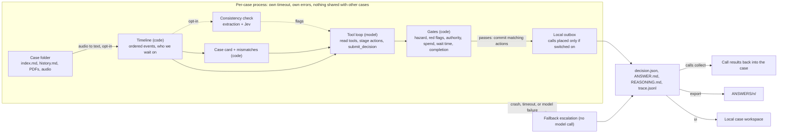

# lettable: design

Status: current as of `main`. Describes the shipped system in `agent/`. Thresholds live in `agent/config.py` and can be overridden per run with `--config file.json`; values quoted here are the defaults.

Related: [output-format.md](output-format.md) (the files a run writes), [voice.md](voice.md) (phone calls and speech-to-text).

## 1. Purpose

Lettings teams work repair cases that arrive as emails, calls, texts and holds, often with details missing or conflicting. Most of the work is deciding the next step and who the case is waiting on. lettable reads each case up to now, proposes the next action, checks it in code, and either records the action or hands the case to a person with what is known, what is missing and two or three options.

### Goals

- Every case gets an output, including when the model, the network or the input fails.
- The model proposes; deterministic code decides. Code can make an outcome stricter (wait or escalate), never looser.
- Anything unsafe, unclear, unapproved or above the spend limit goes to a person.
- Every decision is explainable from the case: reasons, evidence refs (`event-NNN`, attachment names) and the gates that fired.
- Paid and outbound features are off unless switched on by name.

### Non-goals

- Sending email or SMS, or writing to a CRM or ticketing system. Messages, approval requests and closures are local records (see section 9).
- Approving spend. The agency has no spend authority of its own; amounts above the limit are routed to the landlord or a person.
- Legal, deposit or notice advice. These cases are escalated.

## 2. Architecture

### Components

| Module | Responsibility |
|---|---|
| `agent/timeline.py` | Parse a case into ordered events and attachments; work out who the case is waiting on and since when |
| `agent/details.py` | The case card (`case-card/1`): tenant, landlord, provider, property, amounts, dates, each with refs. Code only, never guesses |
| `agent/mismatches.py` | Conservative code detectors: addresses, invoice amounts against quotes and approval, completion against later reports, contact details |
| `agent/consistency.py` | Opt-in document consistency check (section 5) |
| `agent/loop.py`, `agent/tools.py`, `agent/policy.py`, `agent/chat.py` | Bounded tool loop, its read and staging tools, the operating policy, the Claude and OpenAI clients |
| `agent/gates.py`, `agent/evidence.py`, `agent/redflags.py` | Code checks on the final decision |
| `agent/handover.py` | Fills the escalation packet (route, priority, options) when the model leaves gaps; only moves stricter |
| `agent/channel.py`, `agent/calls.py`, `agent/oncall.py`, `agent/voice*.py`, `agent/stt.py` | Phone policy, dialer, on-call briefing, phone agent, speech-to-text |
| `agent/runner.py`, `agent/fallback.py` | Per-case process isolation, time limits, concurrency, resume, fallback escalation |
| `agent/report.py`, `agent/files.py`, `agent/export.py` | Output files, atomic writes, the `ANSWERS/` exporter |
| `agent/reality.py`, `agent/doctor.py` | Batch run over an unknown folder layout; preflight checks |
| `agent/replay.py`, `agent/grade.py` | Evaluation without an answer key; grading against rubrics |
| `agent/ui.py`, `agent/ui_static/` | Read-only local case workspace |

### Backends

| `--backend` | What runs | Cost |
|---|---|---|
| `fake` (default) | Offline rules backend; no network | free |
| `claude` | Tool loop on Claude; PDFs and images attached to the first message | paid |
| `openai` | Tool loop on OpenAI | paid |
| `auto` | Claude when `ANTHROPIC_API_KEY` is set, otherwise OpenAI | paid |
| `anthropic-single` | Older one-call path; needs the `anthropic` extra | paid |

A key in the environment does not switch on spend by itself; the backend must be named.

## 3. Decision flow for one case

1. **Load.** The runner starts a child process for the case with its own time budget (`case_timeout_s`, 240 s). The recorded summary and outcome in `index.md` are never loaded, so a case's ending cannot leak into the decision.
2. **Build the timeline.** Events are ordered; audio is transcribed when `--stt` is on; PDFs are read with `pypdf`. Files over `max_file_bytes` and unknown types become warnings, not crashes.
3. **Code facts.** The case card, mismatches, hazard hits and red flags are computed before the model sees the case.
4. **Tool loop.** The model calls read tools (events, search, attachments, case files, policy) and stages actions through gated tools, then calls `submit_decision` once.
   - Nothing leaves the case during the loop. Each staging tool is checked by code first; a refusal goes back to the model with a reason and a hint.
   - Bounded by `loop_max_steps` (12) and repeated-call detection. Token use is recorded on the decision and never stops a case or skips later cases.
   - A turn without a tool call gets a nudge. The Claude client uses `tool_choice: auto` because the configured model rejects forced tool use.
   - If the model never submits, the case escalates with its trace; no extra model call.
5. **Gates.** `gates.apply` checks the proposal (section 4). If a gate changes the action, every staged action except escalations and safety advice is held for a person instead of committed.
6. **Commit.** Staged actions that match the final action are written to the local outbox. Phone calls go through the dialer only when calls are switched on and the phone policy allows them.
7. **Write.** `ANSWER.md`, `REASONING.md`, `trace.jsonl`, then `decision.json` last. Every file is written to a temp file and renamed.

Waits are judged as of the latest event (`as_of = last_event`) by default, because case dates may not relate to the wall clock. `--now` or `--as-of now|later` change that for live use.

## 4. Gates and safety model

Gates run in this order on every model decision. Each can only make the outcome stricter.

| Check | Effect |
|---|---|
| Hazard phrase in the latest `hazard_window` (5) events or attachments (gas, CO, flood, exposed wiring, fire, collapse, unsafe-to-use, threats, mould with an infant, no heating with a vulnerable occupant). Negated mentions and agency advice do not count | Escalate |
| Forcing red flag: payment redirection (new bank details), legal (deposit, notice, claims), vulnerable occupant without heat, water or power, abuse toward staff | Escalate, with routing guidance |
| Consistency check finds a clearly different property address or payee | Escalate |
| Model confidence below `min_confidence` (0.5), unless the decision is a verified wait | Escalate |
| Action that needs a message, proposed without one | Escalate |
| Chase a party the timeline is not waiting on | Escalate |
| Chase or new question before `chase_after_days` (3) | Wait |
| Instruct the provider without a landlord approval dated after the latest quote | Escalate |
| Close without confirmed completion from the provider or tenant | Escalate |
| Amount above `approval_limit_gbp` (GBP 300) not covered by a landlord approval | Escalate |

A failed earlier action (bounce, no-show, repeated voicemail) is a non-forcing red flag: it is shown to the model with recovery guidance so it can try another channel.

Escalation always passes; no gate blocks it. A proposal must carry a reason, and unverified evidence alone is not a reason to escalate. The handover packet is completed by code when the model leaves gaps: route and priority (P0 to P3, with target response times of 1, 4, 24 and 72 hours) only move stricter, and a payment flag becomes accounts at P1 or above.

### What the proposal can be

| What the timeline shows | Proposed action |
|---|---|
| Landlord approval requested, no reply for too long | `CHASE_LANDLORD` |
| Provider asked to quote or book, no answer or only voicemail | `CHASE_PROVIDER` |
| Quote or invoice arrived | route for approval |
| Landlord approved, provider not yet told | `INSTRUCT_PROVIDER` |
| Details missing, or an attachment marked unavailable | `ASK_TENANT`, `ASK_PROVIDER`, `ASK_LANDLORD` |
| Appointment booked | send reminder |
| Work done, invoice and key return settled | `CLOSE` |
| Nothing due yet | `WAIT` |
| Hazard, conflicting facts, a dispute, or the model is unsure | `ESCALATE` |

### Phone calls

The model may ask for a call; `agent/channel.py` decides whether the phone is the right channel: at least `call_after_unanswered` (2) unanswered written messages to that party with the latest at least `call_after_hours` (24) old, a bounce, or a hazard found by code. Live calls are further limited to 08:00 to 21:00 UK time, `max_calls_per_case` (1) and `max_calls_per_run` (10), a number found in the case, and the allow-list when set. A live call is never retried after a timeout or 5xx; the call ledger keeps it pending so it is not dialled twice.

The on-call briefing is fully code-driven: when a case ends with a code-found hazard or priority P0, the runner adds one briefing call to `LETTABLE_ONCALL_NUMBER`. That number is never taken from a case or the model, and a live briefing is dialled only if the number is on `LETTABLE_CALL_ALLOWLIST`. Details: [voice.md](voice.md).

## 5. Document consistency check (opt-in)

Off by default (`consistency_check: false`). Some cases contain conflicting identity or property details: a forwarded email with a different address, a call naming another flat, a quote for a different property.

1. **Extract (model, one call).** Every mention of tenant and landlord names, phones and emails, the property address and reference numbers, verbatim, each with its source. A name counts for a role only when the text makes the role explicit.
2. **Verify (code).** A value not present in the source it cites is dropped. Values equal after normalising (case, spacing, punctuation, `+44` prefix) pass.
3. **Score (Jev).** Remaining differences go to Jev (`api.typesafe.ai`, `jev-1.13.0`) in one request, scored 0 to 3 and normalised to 0 to 1.
4. **Tier (code).** At or above `jev_pass` (0.85): pass. Below `jev_escalate` (0.4) with confidence at least `jev_min_confidence` (0.6): escalate. Otherwise flag. Names, phones, emails and reference numbers are capped at flag; only a clearly different property address or payee can escalate.

Flags are shown to the loop model and saved under `consistency` in `decision.json`, as step 0 in the trace and in `REASONING.md`. If extraction or Jev fails, or `TYPESAFE_API_KEY` is unset, the report is `unavailable` and the case continues: an outage of the check must not escalate every case.

Cost: about 2,500 to 5,000 model tokens plus one Jev call (about 500 tokens, 0.3 s) per case. On a small sample it did not improve agreement, so it stays off by default.

## 6. Failure handling

| Failure | Behaviour |
|---|---|
| Model timeout, HTTP 408, 429, 5xx, network error | Retry up to `max_retries` (4), honouring `retry-after` up to `retry_after_cap_s` (30 s) |
| Model returns malformed output or never submits | Fallback escalation with the trace |
| Case exceeds `case_timeout_s` or crashes | Child process is stopped; fallback escalation written without a model call |
| Whole run exceeds `--deadline` | Unfinished cases get fallback escalations; `reality` makes further passes over fallbacks while time allows |
| Corrupt, oversized or unknown input file | Warning on the case; the case continues |
| Live call times out after it may have been placed | Kept pending in the call ledger; not redialled |
| Consistency check or speech-to-text unavailable | Feature reports `unavailable`; the case continues |

Invariants: one output per input case (`summary.json` checks it), no state shared between cases, and `decision.json` written last so a half-written case is never read as finished. `--resume` skips cases already decided by the model and redoes fallbacks.

## 7. Data handling and security

- Secrets are read from the environment only. `.env` is gitignored; `.env.example` holds names, never values. `doctor` reports whether a key is present and never prints it.
- Case text, and with `--backend claude` the PDFs and images, are sent to the model provider that is switched on. Audio goes to ElevenLabs only with `--stt elevenlabs`. Field values go to Jev only with the consistency check on. Nothing else leaves the machine.
- Outbound phone numbers come from the case or, for the on-call briefing, from configuration; never from model output alone. The allow-list restricts live dialling.
- The UI binds to 127.0.0.1, ignores symlinked case folders and writes only `review.json`.
- Output folders (`out/`, `runs/`, `results/`) and the speech-to-text cache are gitignored. Treat them as containing personal data.

## 8. Operations

**Preflight.** `uv run python -m agent doctor <cases> --backend claude --live` checks keys, `pypdf`, that the output folder is writable, that cases can be found, and makes one tiny model call to confirm the key and model name. A wrong model name otherwise turns every case into a fallback.

**Run.** `run` for a known folder of cases; `reality` for a folder of unknown layout (finds cases at any depth, stages them, runs them with the normal runner, retries fallbacks while the deadline allows, and exports `ANSWERS/<n>/`). `reality` reads `reality.json` at the repo root by default.

**Observe.** Each case writes `trace.jsonl` (every model turn, tool call, gate verdict and committed action) and the run writes `summary.json` (counts by action, fallbacks by cause, write errors, elapsed time, and `reconciled`, which is true only when every input case has an output). Token use is recorded per case in `decision.json`. `ui` shows both per case.

**Recover.** Re-run with `--resume` to redo only fallbacks. `calls collect` brings finished phone calls back into `decision.json`; re-run the case to use them.

**Tune.** Change thresholds through a `--config` JSON file rather than code. The values most likely to need local settings are `approval_limit_gbp`, `chase_after_days`, `call_hours`, `case_timeout_s`, `concurrency` and `hazard_patterns`.

## 9. Testing and evaluation

- **Unit and integration tests** (`tests/`, standard-library `unittest`, about 490 tests, offline). Fake backends cover the model, phone and speech-to-text, including chaos backends that inject hangs, crashes, corrupt files and model errors. CI runs them on Ubuntu and Windows with Python 3.9 and 3.12.
- **Replay.** Cases have no labels but each has a recorded history. Replay cuts a finished case at a point, shows the agent only the events before it (attachments dropped, summary and outcome hidden) and compares the proposed action with what the agency did next. The "what happened next" label is a rough rule, so the result is agreement, not accuracy, and differences are read by hand before anything is tuned.
- **Held-out hygiene.** The 50 public cases are split with a fixed seed into 25 dev and 25 holdout cases. Disagreements are read only on dev cases; the holdout is scored, not read, and changes must be general rules seen in more than one case.
- **Grading.** `grade` checks a run against `<id>.expected.json` rubrics kept outside the case folders (acceptable actions, prohibited commits, escalation route and priority, required terms, expected red flags). An optional model judge scores the reasoning; it is advisory.
- **Voice.** `voice-test` runs phone-free scenarios through the ElevenLabs conversation simulator.

### Replay findings (dev split)

First real run, 15 dev cases at 2 points each, Claude tool loop:

| Run | Agree | Differ | Escalated (scored points) | Unscored | All escalations of 30 |
|---|---|---|---|---|---|
| Baseline | 4 | 6 | 11 | 9 | 14 |
| With consistency check | 2 | 7 | 12 | 9 | 16 |

Twenty-one points are scored and Claude varies between runs, so these numbers are for reading rather than ranking. Two patterns account for most differences and are tracked in section 10.

## 10. Known limitations

- **Completion is under-detected.** Providers that sign as a firm are not recognised as providers, and wording such as "this one is done" is missed ([#11](https://github.com/kulakovvad/lettable/issues/11)). The close gate wrongly treats "no keys held" as missing key evidence ([#6](https://github.com/kulakovvad/lettable/issues/6)). In replay, 8 of 10 points where the agency closed next were escalated.
- **Chase timing is a fixed 3 days** rather than the hold's own "(N days)" ([#7](https://github.com/kulakovvad/lettable/issues/7)).
- **The tenant update staged with `INSTRUCT_PROVIDER` is held** although the policy suggests sending it ([#8](https://github.com/kulakovvad/lettable/issues/8)).
- **The first landlord approval request cannot go out.** At the start of a repair the model drafts it and submits `WAIT`; `route_for_approval` needs an amount already in the case and `chase` needs an earlier request, so the draft is held for review (6 of 30 replay points).
- **`GBP 300` approval limit is a placeholder** until the agency sets its own.
- **Hazard detection is pattern-based** plus the model's judgement; when unsure the agent escalates.
- **PDFs** are read only with `pypdf`; scanned pages show as "content not available". Replay drops attachments.
- **Voice:** no inbound calls, text-to-speech replies or voicemail drops. Dry runs skip the calling-hours check. `calls collect` rewrites `decision.json` without a lock, so do not run it concurrently with a run on the same folder.
- **Tuning** is limited to a small replay of the public cases; there is no run on a large held-out set.

## 11. Before go-live

The decision core, isolation and safety gates are complete and tested. Putting it in front of real tenants and landlords also needs:

1. A real action layer: send email and SMS, create tickets, and read the state back before retrying, with the same idempotency keys the outbox already records.
2. The agency's own approval limit, chase timing and calling hours in a reviewed `--config` file.
3. Fixes for #6, #7, #8 and #11, measured with replay on the holdout split.
4. A data-processing review for every external service switched on (model provider, ElevenLabs, Twilio, Jev) and a retention policy for output folders and the speech-to-text cache.
5. Review of the legal and safety message templates by someone qualified in UK lettings.
6. Feeding `review.json` choices from the UI back into the case, so a person's decision closes the loop.
