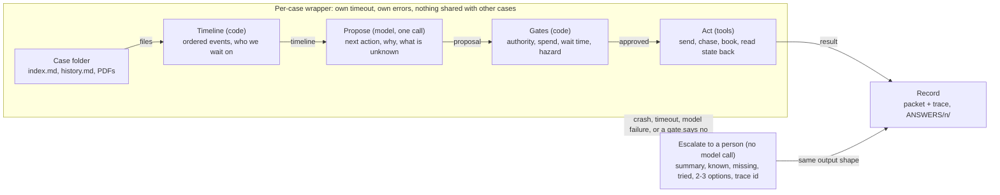

# Case loop design

Status: draft, based on the 50 public Property Management cases. Thresholds are config values and are not fixed here.

## Idea

Every case is a timeline of emails, calls, texts and holds. The agent reads it up to now and proposes the next action. Code decides whether that action is allowed. Anything that fails or cannot be approved becomes an escalation to a person, so no case is ever left without an output.

## Flow for one case

The model only proposes. The gates and the wrapper are plain code, so a bad proposal, a hung call or a crash all end in the same place: an escalation packet a person can pick up without redoing the work.

## What the proposal can be

The public cases are mostly repairs that sit in waiting states: for the landlord, a provider or the tenant.

| What the timeline shows | Proposed action | Gate that must pass |
|---|---|---|
| Landlord approval requested, no reply for too long | chase landlord | Wait limit reached; message uses the approved template |
| Provider asked to quote or book, no answer, or only voicemail | chase provider | Wait limit reached; after repeated misses, offer another provider |
| Quote or invoice arrived | route for approval | Amount against the approval limit and the quote already agreed |
| Details missing, or an attachment is marked unavailable | ask tenant | The missing fact can actually be asked for |
| Appointment booked | send reminder | Date and contact number come from the record, not the model |
| Work done, invoice and key return settled | close | Completion confirmed by the provider or tenant |
| Hazard words, conflicting facts, a dispute, or the model is unsure | escalate to person | Always allowed; never blocked by a gate |

## Per-case isolation

- One case is one unit of work with a catch-all around it. No state is shared between cases.
- Each case has its own time budget. When it runs out, or anything crashes, the fallback escalation packet is written.
- Results are written atomically as each case finishes.
- Retries only for timeouts, rate limits and 5xx errors. Actions use an idempotency key and read the state back before any retry.

## Testing without an answer key

The cases have no labels, but each has a recorded history. Pick a point in the history, give the loop only the events up to that point, hide the summary and outcome, and compare the proposed action with what happened next. A different action is not automatically wrong, so differences are read by hand before anything is tuned.

Crash tests: inject a hang, a corrupt file and a model error into one case of ten, and check that the other nine finish and the broken one escalates within its time budget.

## Reuse from the old agent

Keep:
- The rule that the model proposes and code decides
- Per-case isolation and the escalation fallback
- Tracing, retries, spend caps, idempotent actions
- Escalation and spend-authority rules

Rewrite or drop:
- Ingest, since the input is now markdown timelines and PDFs, with no CRM
- The one-shot nine-outcome packet and the grader upload
- The fraud, identity and PII gates, which suit the old task more than routine repairs

## Amendment (proposed): bounded tool loop instead of one call

Status: proposed in the `vikkash/agent-loop` PR, needs team agreement.

"Propose" becomes a bounded loop: the model may call read tools (events, search, attachments, case files, policy) and *stage* actions through gated tools before one `submit_decision`. The principle is unchanged: the model only proposes, code decides.

- Nothing leaves the case during the loop. Action tools only stage; each is checked by code first and a refusal is returned to the model with a reason and a hint, so it can pick a different action.
- After `submit_decision`, the existing `gates.apply` runs as before. If it changes the decision, every staged action except escalations and safety advice is held for a person instead of committed.
- Bounded by turns (`loop_max_steps`), a token budget and repeated-call detection. If the model never submits, the case escalates with its trace; no extra model call.
- Waits are judged as of the latest event (`as_of = last_event`), because synthetic case dates do not relate to the wall clock.
- Adds one action, `INSTRUCT_PROVIDER` (landlord approved, provider not yet told to go ahead), gated on a landlord approval dated after the latest quote.

## Open questions

The output format and any tools or CRM for the real challenge cases are not known yet. The packet and the "Act" step stay provisional until we see them.
