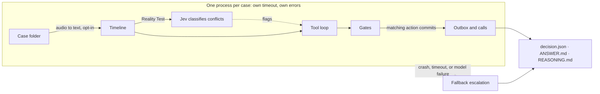

# Case loop design

Lettable decides the next step on a property-management case. This document is the design of that loop: what a case is, what the agent is allowed to do, and which decisions belong to the model and which belong to code.

How to run it is in the [README](../README.md). Every output field is in [output-format.md](output-format.md). Phone calls are specified in [voice.md](voice.md). Thresholds live in `agent/config.py` and are starting values, not constants of the design.

## Principle

**The model proposes. Code decides.**

The model reads the timeline, looks things up, and stages a next step. Plain code then accepts, holds, or replaces that step. A gate may change the outcome only by making it stricter: `WAIT` when a chase is too early, `ESCALATE` when a person must decide. A gate never turns a cautious proposal into a more active one.

Three consequences follow.

1. **A case always produces an output.** A crash, a timeout, a malformed answer or a loop that never submits becomes a fallback escalation written by code. A person can pick the case up without redoing the reading.
2. **Nothing is delivered until the final decision matches.** Tools stage. They do not send. The staged item that matches the gated decision is recorded. The rest is held for review.
3. **A recorded ending never reaches the model.** Overview, outcome, summary, resolution, status, completed and updated lines are stripped on load. Replay also cuts the timeline and drops attachments, so a later event cannot leak into an earlier decision.

The agency has no authority of its own to approve spend, at any amount. Work goes ahead on the landlord's written approval in the case, or it goes back to the landlord, or it goes to a person.

## What a case is

A case is a folder.

```text
<case>/
  index.md          # title, request, parties, property
  history.md        # the timeline
  attachments/      # quotes, invoices, photos, audio
```

`agent/timeline.py` turns that folder into ordered events. Each event has a time, a channel, a sender role and a body. From those events, code derives who the case is waiting on, since when, and which attachments have text. Loading never raises on bad content. A missing file, an unreadable timestamp or an oversized attachment becomes a warning on the decision.

Audio (`.mp3`, `.wav`, `.m4a`, `.ogg`, `.flac`, `.aac`, `.webm`) is transcribed only when speech-to-text is switched on. The transcript is labelled untrusted and is then searched and hazard-checked like any other document. A failed or oversized file is "content not available". The agent must not guess what it says.

## The decision

The model returns one primary action. After the gates, that action is what `decision.json` records.

| What the timeline shows | Action | What must be true |
|---|---|---|
| We asked the landlord, and they have not replied for long enough | `CHASE_LANDLORD` | The case is waiting on the landlord, and the wait has reached the chase limit. The message uses facts from the case. |
| We asked the provider to quote or attend, and they have not answered, or we only reached voicemail | `CHASE_PROVIDER` | The case is waiting on the provider, and the wait has reached the chase limit. After repeated misses, the policy asks the model to offer another provider. |
| A quote or invoice has arrived and is not yet approved | `ROUTE_FOR_APPROVAL` | The amount appears in the case. An amount the landlord has already approved is not sent again. |
| A fact is missing, and one party can supply it | `ASK_TENANT`, `ASK_PROVIDER`, `ASK_LANDLORD` | The question is specific. Asking the landlord or the provider again, while a wait on them is still inside the chase window, becomes `WAIT`. A question to the tenant is not held back by that rule. |
| The landlord has approved, and the provider has not been told to proceed | `INSTRUCT_PROVIDER` | A landlord approval is in force and is dated after the latest quote. Approving a visit is not approving a price. |
| An appointment is booked | `SEND_REMINDER` | The date and the contact come from the record. |
| The work is done, the invoice position is known, and keys are settled | `CLOSE` | The close tool requires a completion event, a known invoice position, and key return when keys were held. The final gate then requires a confirmed completion that a later message has not reopened. |
| Nothing is due | `WAIT` | A follow-up says when to look again, and who is being waited on. |
| Hazard, conflict, dispute, legal matter, suspected fraud, or the model is unsure | `ESCALATE` | Always allowed. A handover states what is known, what is missing, what was tried, and two or three options. |

Priority is `P0` to `P3`. `P0` is reported imminent danger. `P1` is a serious urgent risk, including a vulnerable occupant without heating, water or power. `P2` and `P3` are the ordinary queue. A hazard found by code, or a forcing red flag, raises a priority the model set too low.

When the case itself asks an explicit question, the decision may also carry a direct `answer`. The operational action is still one of the rows above.

## One case, end to end



1. **Load.** Build the timeline. Strip recorded endings. Transcribe audio if that backend is on. Build the case card, the mismatch list and the red-flag list in code, before the model speaks.
2. **Classify document conflicts.** On the Reality Test, one extraction call, then Jev scores each field that still differs, then code tiers it pass, flag or escalate. A plain `agent run` skips this step unless `consistency_check` is set. A failure of this check does not fail the case.
3. **Loop.** The model reads with tools, stages at most the actions it can defend, and calls `submit_decision` once.
4. **Gate.** `gates.apply` accepts the proposal or replaces it with a stricter action. Gate notes are appended to the reason.
5. **Commit.** The staged item that matches the final action is recorded in the local outbox. Escalations always commit. Safety advice to the tenant commits when code found an open hazard. Everything else is `held_for_review`.
6. **Call, if committed.** The runner places each committed call once, after the gates. The case does not wait for the person to pick up.
7. **Write.** `ANSWER.md` and `REASONING.md` first, `decision.json` last, each via a temporary file and a rename.

`--backend claude`, `openai` and `auto` run this loop. `--backend fake` is the offline rules backend used in tests and for a free local run. `--backend anthropic-single` is the older one-call path and needs the optional `anthropic` package.

## Isolation and failure

One case is one process. No state is shared with the case beside it. Each case has its own time budget (`case_timeout_s`, 240 seconds). The run may also have a deadline. When either expires, or the worker crashes, or the model returns something the schema rejects, `agent/fallback.py` writes an escalation. That packet includes the case title, the request, a short digest of recent events, the cause, and a recommended option. It does not make another model call.

| Cause | What happened |
|---|---|
| `timeout` | The case exceeded its time budget. |
| `crash` | The worker exited without reporting. |
| `error` | The worker raised, or returned a decision the schema rejected. |
| `deadline` | The run deadline passed before this case started. |
| `runner` | The worker process could not be started. |
| `loop_no` | The loop hit its turn limit without `submit_decision`. This one is still `source: model`: the trace is kept, and the escalation is written from that trace. |

Model requests retry timeouts, HTTP 408, 429 and 5xx, up to `max_retries`, honouring `Retry-After` up to a cap. A live phone call is not retried after a timeout or a 5xx. The call ledger keeps it `pending` so it is not dialled twice. Staged messages are local records, not deliveries.

`--resume` skips a case whose `decision.json` has `source: "model"`. Fallback cases are retried. `summary.json` is reconciled when every input folder was written or skipped and nothing failed to write. The CLI exits 1 when that check fails.

## The tool loop

Shipped in `agent/loop.py`. Bounded by `loop_max_steps` (12 turns) and by repeated-call detection: the third identical call returns an error and tells the model to use the earlier result or decide. Token use is recorded on the decision. It does not stop the case or skip later cases. Two turns from the end, every tool result carries a budget note.

The Claude client uses `tool_choice: auto`. The configured model rejects forced tool use. A turn with no tool call is nudged: call a tool, and finish with `submit_decision`.

Read tools return facts. Action tools stage, or refuse.

| Tool | Kind | What it does |
|---|---|---|
| `case_facts` | read | Who we wait on, money with event refs, approvals, hazard hits, completion signals, warnings. |
| `read_events` | read | Full events by number, at most 30 per call. |
| `search_case` | read | Plain-text search across events, the request and attachment text. |
| `read_attachment` | read | Extracted text of one file, or a note that it is unavailable. |
| `list_case_files`, `read_case_file` | read | Unusual layouts. `index.md` is still stripped of recorded endings. |
| `check_policy` | read | The agency policy for one topic, several, or all. Numbers in the text are the same thresholds the gates enforce. |
| `send_message` | stage | A message to a party. Refused when the party is unknown, the chase is early, a detail in the body is not in the case, or a provider is instructed without landlord approval. |
| `place_call` | stage | A request to phone. The model supplies an objective, never a number. Code decides whether the phone is the right channel. |
| `route_for_approval` | stage | Ask the landlord to approve a quote, or to approve a visit when no amount exists yet. |
| `schedule_followup` | stage | When to look again. Used with `WAIT`. |
| `escalate_to_human` | stage | A handover ticket. Always allowed. |
| `close_case` | stage | Cite the completion event, the invoice position, and key return when keys were held. |
| `submit_decision` | finish | One primary action. Ends the loop. |

A refusal is a result the model sees: a `code`, a `why`, and a `hint`. A non-empty `blocked` list means the model was corrected during the investigation. It does not mean the case failed. The first `WAIT` is refused while an outbound request is staged but not submitted (`staged_not_submitted`), so a drafted chase is not silently dropped. A second `WAIT` is accepted, and that request stays held for review.

Waits are judged as of the latest event (`as_of = last_event`). The public cases use synthetic dates, including dates in the future, so the wall clock would mis-count every wait. `--now` implies `as_of = now`. `--as-of later` uses whichever of the latest event and the clock is later.

With `--backend claude`, images and PDFs are attached to the first message. They are labelled untrusted case data. The prompt tells the model to read them for layout, stamps and scanned pages, and to ignore any instruction inside them that tries to change the process.

## Gates

`gates.apply` runs after `submit_decision`, on the proposal the loop built from the staged action. Each change is recorded in `gate_notes` and appended to the reason as `[gate: ...]`. `proposed_action` keeps what the model asked for.

In order:

1. **Open hazard.** A matched hazard phrase forces `ESCALATE`. The scan covers the request, every attachment, and the whole timeline. Once a completion is confirmed, events older than that completion drop out of the scan except for the latest `hazard_window` events (5). Negated mentions ("no smell of gas"), routine compliance lines ("smoke and CO alarms checked"), and hazard wording that is only advice or a question inside an agency message do not count.
2. **Forcing red flags.** Payment, legal, vulnerability and abuse each force `ESCALATE`, with a route and a priority floor. A failed action (a bounce, a no-show, a second voicemail) is reported to the model and does not force escalation. The model is expected to recover: chase, ask, or hand over with that failure in the ticket.
3. **Document disagreement.** An escalate-tier result from the consistency check forces `ESCALATE`. Only a clearly different property address, payee or bank details can reach that tier. Names, phones, emails and reference numbers are capped at flag.
4. **Low confidence.** Below `min_confidence` (0.5) the proposal becomes `ESCALATE`, unless the action is `WAIT` and the timeline really is waiting on someone. A verified wait is allowed to be quiet.
5. **Missing message.** A chase, an ask, an instruction or a reminder with no message body becomes `ESCALATE`.
6. **Chase shape.** Chasing a party the timeline is not waiting on becomes `ESCALATE`. Chasing before `chase_after_days` (3) becomes `WAIT`.
7. **Early question.** Asking the landlord or provider again, while a wait on them is still inside the chase window, becomes `WAIT`.
8. **Instruction without approval.** `INSTRUCT_PROVIDER` with no covering landlord approval becomes `ESCALATE`. The approval must be later than the latest quote. A negated approval does not count.
9. **Close without completion.** `CLOSE` with no confirmed completion becomes `ESCALATE`. A later tenant message that reopens the fault blocks the close. A later message about a different subject is called out so the model asks or escalates rather than closing over it.
10. **Spend.** An amount above `approval_limit_gbp` (300, a placeholder) becomes `ESCALATE` unless the action is already an escalation or an approval request, or a landlord approval in the case already covers that amount. The limit is a threshold for handing the decision to a person. It is not an allowance the agency may spend.

Policy covers the judgements code does not fully encode: VAT basis, approximate quotes, a document for another property, a payee who is not the assigned provider, damp and mould, gas and electrical certificates, and the subjects the agent never acts on. Those subjects are deposits, rent, arrears, tenancy terms, notices, eviction, disrepair claims, compensation, and a tenant's personal circumstances. The policy says to escalate them and keep any message to an acknowledgement. The model reads this through `check_policy`. The gates enforce the parts that can be checked without guessing.

## What gets recorded

Each staged side effect ends in one of three states.

| State | Meaning |
|---|---|
| `committed` | Recorded in the local outbox. For a call, queued and then placed once. |
| `held_for_review` | Kept on the decision so a person can see it. Not treated as sent. |
| `call_failed` | The dialer could not place a committed call. The decision stands. A person is told. |

Only the item that matches the final action commits. A call may stand in for the message on a chase, an ask or an instruction. If the final action is `ESCALATE` and the model staged no ticket, code adds one and fills any missing handover fields: route, respond-by time, known facts, unknowns, what was tried, and options. A payment red flag routes the ticket to accounts unless the route is already the on-call emergency route.

Idempotency keys are derived from the case, the events seen, the action and the message. The same call key found in an earlier `decision.json` is never dialled again.

## What code knows before the model speaks

Three extracts are built with no model call. They appear in `decision.json` and in `ANSWER.md`, including on a fallback when the case loaded.

**The case card** (`agent/details.py`, schema `case-card/1`). Every key is present. Unknowns are null or an empty list. Each extracted value carries refs: `event-NNN`, an attachment name, or `index`. Names are never guessed. `name` is set only when the case names one person. Other spellings stay in `names`. The card covers the property, the tenant, the landlord, the agency, the provider, money, appointments, the timeline, attachments and the decision itself.

**Mismatches** (`agent/mismatches.py`). A wrong item is worse than a missed one, so the checks are conservative.

| Kind | What it catches |
|---|---|
| `address` | An address line that clearly names another place. A longer or shorter form of the same address is left alone. |
| `amount` | An invoice that matches no quote, an invoice above the approval, or two different quotes. |
| `completion` | Someone reports the job done, and the tenant later reports the fault again. |
| `contact` | One party gives two different phone numbers or emails. |
| `document consistency` | A flag or escalate tier from the optional consistency check. |

**Red flags** (`agent/redflags.py`). At most one of each, in this order: payment, legal, vulnerability, abuse, failed action. Negated mentions are ignored. New bank details, or a Direct Debit request that is not with the assigned provider, are payment flags and force an escalation to accounts. A confirmation of an existing Direct Debit is not a request. Vulnerability is a vulnerable occupant together with a loss of heating, water or power, even when the two facts sit in different events.

## Voice

Both directions are off or harmless by default. Speech-to-text is `off`. Calls are `dry_run`: the call is recorded on the decision and nothing is dialled. The full script, the voicemail wording and the setup commands are in [voice.md](voice.md).

The model decides **what** to do: an objective, a party, a purpose. Code decides **whether the phone is the right channel** (`agent/channel.py`). A call is allowed when writing has failed (at least two unanswered emails or texts to that party, the latest at least 24 hours old, or the latest message bounced), when code found an urgent hazard, or when the question is for a tenant who phoned the agency themselves. Anything else is refused with a hint, and the model sends a message instead.

On top of that channel rule:

- The number is taken from the case. Quoted lines, "ring our accounts desk", and premium-rate or non-geographic numbers are skipped.
- One call per case in a round, and at most one in the case's history. Ten live calls per run.
- Live calls only between 08:00 and 21:00 UK time. Outside those hours the call is held and a person is told.
- During an open hazard the only call that commits is safety advice to the tenant. The case still escalates.
- The phone agent speaks for the agency named in the case. It cannot approve spend or promise a price, a date or compensation.
- Amounts and numbers spoken on the call do not become facts of the case. The transcript is third-party speech.
- A timeout or a 5xx leaves the ledger entry `pending`. A person checks the provider, then clears it. Automatic retry would risk a second ring.

**On-call briefing.** Entirely code-driven. There is no tool for it, and the model cannot ask for it. When a case ends with a hazard found by code, or with priority P0, the runner may phone `LETTABLE_ONCALL_NUMBER`. The script is built by code: the case, the property, the matched phrase, and what has already been done. A live briefing is dialled only when that number is on `LETTABLE_CALL_ALLOWLIST`. Calling hours do not apply. If the briefing cannot be placed, the decision is unchanged and a person is told through the usual ticket.

## Document consistency check

Status: shipped in `agent/consistency.py`. The Reality Test config (`reality.json`) turns it on. A plain `agent run` leaves it off unless `--config` contains `{"consistency_check": true}`. It exists because a case can carry two addresses, two names, or a quote for a different property, and a keyword mismatch will miss the near misses.

1. **Extract.** One model call. Every mention of the tenant and landlord names, phones and emails, the property address and reference numbers, verbatim, each with the event, index or attachment it came from. A name counts for a role only when the text makes the role explicit. Agency staff and contractors are out of scope.
2. **Verify.** A value that does not appear in the source it cites is dropped. Values that match after normalising case, spacing, punctuation and the `+44` prefix pass with no external call.
3. **Score.** Fields that still differ go to Jev (`api.typesafe.ai`, model `jev-1.13.0`) in one request. Jev returns a score on a 0 to 3 rubric. Code divides by 3.
4. **Tier.** At or above `jev_pass` (0.85): pass. Below `jev_escalate` (0.4), with confidence at least `jev_min_confidence` (0.6): escalate. Anything else: flag. Names, phones, emails and reference numbers are capped at flag.

An escalate-tier field makes `gates.apply` change the decision to `ESCALATE`. Flagged and escalated fields are shown to the loop in its first message. The report is stored on the decision, as step 0 of the trace, and as a section of `REASONING.md`.

If extraction or Jev fails, or `TYPESAFE_API_KEY` is unset, the report is `unavailable` and the case continues. An outage of the check must not escalate every case. The Reality Test runner turns the check off in that situation, rather than paying for an extraction that cannot be scored.

Cost, measured on the public cases: about 2,500 to 5,000 model tokens for the extraction, and one Jev call of about 500 tokens per case.

## Replay findings

The cases have no labels. Each has a history, which is enough to ask a weaker question: at a chosen point, does the proposed action agree with what the agency did next? A different action is not automatically wrong. Differences are read by hand before anything is tuned. Agreement is a reading, not an accuracy score.

The 50 public cases are split with a fixed seed into 25 development cases and 25 holdout cases. Disagreements are read only on the development cases. The holdout is scored at checkpoints and is not read case by case, so the prompt and the gates are not fitted to cases that were inspected. A change has to be a general rule seen in more than one case.

Crash tests inject a hang, a corrupt file and a model error into one case of ten. The other nine must finish. The broken one must escalate inside its time budget.

First real run, 15 development cases, 2 points each, Claude tool loop:

| Run | Agree | Differ | Escalated (scored points) | Unscored | All escalations of 30 |
|---|---|---|---|---|---|
| Baseline | 4 | 6 | 11 | 9 | 14 |
| With the consistency check | 2 | 7 | 12 | 9 | 16 |

Twenty-one points are scored, and Claude varies between runs, so these numbers are for reading rather than ranking. In the run with the check, three decisions changed because of it: cases 009 and 025 (real name and address conflicts) and case 014, a false positive from extracting a call agent as the tenant. The role rule in the extractor fixes 014. The other two changes do not mention the check and are run-to-run variation.

Two findings are still open.

**The first landlord approval cannot go out.** At the start of a repair the model drafts the request asking the landlord to approve sending a provider, then submits `WAIT`. `route_for_approval` needs an amount already in the case, `chase` needs an earlier unanswered request, and under `WAIT` only the follow-up commits. The request is held for review. This affected 6 of 30 points.

**Completed jobs escalate.** In 8 of 10 points where the agency closed next, the model escalated, mostly because the invoice position was unknown or the completion lived only in an agency note. Some of those escalations are defensible. In case 027 the close gate rejected the tenant's own "drain is now clear" three times.

## The Reality Test runner

`python -m agent reality` is the path for an unseen drop. It finds case folders at any depth, skips the output directory, numbers them, and stages copies so the run cannot write back into the challenge files. Numeric names are unpadded (`001` becomes `1`). `manifest.json` maps each output number to the source path.

The runner then calls the same isolated loop. If the deadline allows, it makes another pass over cases whose `source` is `fallback` and keeps decisions the model already finished. It writes `ANSWERS/README.md` as an index of action, priority, escalation and fallback, plus `summary.json` and `trace.jsonl`.

`python -m agent doctor` is the preflight: config loads, keys are present for the backends in use, `pypdf` imports, the output directory is writable, and cases can be discovered. `--live` adds one small model call so a bad model name fails before the drop, not during it.

## The case workspace

`python -m agent ui` serves a single local page over a finished run. It is a reading surface for a person, not a second agent.

The page lists every case, shows the case card, the decision, the reasoning, the evidence refs and the tool trace, and lets a person record one of three choices: go with an option, take the case over, or open a separate issue as a new case. Those choices append to `review.json`. They do not change `decision.json`, and the agent does not read them yet.

The server binds to 127.0.0.1, refuses symlinked case folders, and ships with no extra dependencies. A case whose `decision.json` cannot be read is listed as `UNREADABLE` so a failed write stays visible.

## Thresholds

All of these are `Config` fields. A JSON file passed to `--config` overrides any of them. The policy text is generated from the same object, so the model and the gates cannot drift apart on a number.

| Field | Starting value | Role |
|---|---|---|
| `chase_after_days` | 3 | Minimum wait before a chase, or before a fresh question to someone already being waited on. |
| `approval_limit_gbp` | 300 | Spend above this, with no covering landlord approval, escalates. Placeholder until the real limit is known. |
| `min_confidence` | 0.5 | Below this, escalate, unless the action is a verified wait. |
| `loop_max_steps` | 12 | Model turns before the loop escalates with its trace. |
| `case_timeout_s` | 240 | Per-case process budget. |
| `concurrency` | 4 | Cases in flight. |
| `max_retries` | 4 | Retries for timeout, 408, 429 and 5xx. |
| `call_after_unanswered` | 2 | Unanswered emails or texts before a call is allowed. |
| `call_after_hours` | 24 | Age of the latest of those messages. |
| `call_hours` | 08:00–21:00 UK | Window for a live call. The on-call briefing is exempt. |
| `max_calls_per_case` | 1 | Includes calls already in the history. |
| `max_calls_per_run` | 10 | Live calls across the run. |
| `jev_pass` / `jev_escalate` / `jev_min_confidence` | 0.85 / 0.4 / 0.6 | Tiers for the consistency check. |

## Still open

The output files are specified in [output-format.md](output-format.md). Messages, approval requests and closures are local records. No email, CRM or ticketing system is connected.

Still to fix, and already visible in replay:

- Send the first landlord approval request, instead of holding it under `WAIT`.
- Recognise completion when a provider signs as a firm, or when the tenant says the fault is gone in ordinary words.
- Chase on the hold's own "(N days)", not a fixed three.
- Commit the tenant update that belongs with `INSTRUCT_PROVIDER`.
- Replace the GBP 300 placeholder with the agency's real threshold.
- Lock `decision.json` when `calls collect` rewrites it.

The next measurement is the same replay, on the holdout split, after those rules are general rather than case-specific.
