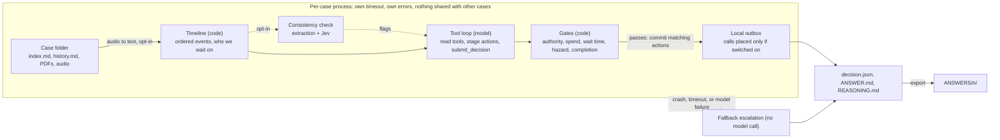

# Case loop design

Status: draft, based on the 50 public Property Management cases. Thresholds are config values and are not fixed here.

## Idea

Every case is a timeline of emails, calls, texts and holds. The agent reads it up to now and proposes the next action. Code decides whether that action is allowed. Anything that fails or cannot be approved becomes an escalation to a person, so no case is ever left without an output.

## Flow for one case

This is the loop in `agent/`. `--backend claude`, `openai` and `auto` run the tool loop. `--backend fake` is the offline rules backend. `--backend anthropic-single` is the older one-call path and needs the optional `anthropic` package. The model proposes; gates and the wrapper are plain code. A bad proposal, a hung call or a crash ends as a fallback escalation, so a person can pick the case up without redoing the work. Staged messages stay in the local outbox. A phone call is the only action that can leave the machine, and only when calls are set to ElevenLabs.

## What the proposal can be

The public cases are mostly repairs that sit in waiting states: for the landlord, a provider or the tenant.

| What the timeline shows | Proposed action | Gate that must pass |
|---|---|---|
| Landlord approval requested, no reply for too long | chase landlord | Wait limit reached; message uses the approved template |
| Provider asked to quote or book, no answer, or only voicemail | chase provider | Wait limit reached; after repeated misses, offer another provider |
| Quote or invoice arrived | route for approval | Amount against the approval limit and the quote already agreed |
| Details missing, or an attachment is marked unavailable | ask tenant | The missing fact can actually be asked for |
| Appointment booked | send reminder | Date and contact number come from the record, not the model |
| Work done, invoice and key return settled | close | Completion confirmed by the provider or tenant |
| Hazard words, conflicting facts, a dispute, or the model is unsure | escalate to person | Always allowed; never blocked by a gate |

## Per-case isolation

- One case is one unit of work with a catch-all around it. No state is shared between cases.
- Each case has its own time budget. When it runs out, or anything crashes, the fallback escalation packet is written.
- Results are written atomically as each case finishes. `decision.json` is written last.
- Model requests retry timeouts, HTTP 408, 429 and 5xx, up to `max_retries`. A live phone call is not retried after a timeout or 5xx: the call ledger keeps it pending so it is not dialled twice. Staged messages are local records, not deliveries.

## Testing without an answer key

The cases have no labels, but each has a recorded history. Pick a point in the history, give the loop only the events up to that point, hide the summary and outcome, and compare the proposed action with what happened next. A different action is not automatically wrong, so differences are read by hand before anything is tuned.

Crash tests: inject a hang, a corrupt file and a model error into one case of ten, and check that the other nine finish and the broken one escalates within its time budget.

## Reuse from the old agent

Keep:
- The rule that the model proposes and code decides
- Per-case isolation and the escalation fallback
- Tracing, retries, idempotent actions
- Escalation and spend-authority rules

Rewrite or drop:
- Ingest, since the input is now markdown timelines and PDFs, with no CRM
- The one-shot nine-outcome packet and the grader upload
- The fraud, identity and PII gates, which suit the old task more than routine repairs

## Bounded tool loop

Status: shipped in `agent/loop.py`. This is what `--backend claude`, `openai` and `auto` run.

The model may call read tools (events, search, attachments, case files, policy) and *stage* actions through gated tools before one `submit_decision`. The principle is unchanged: the model only proposes, code decides.

- Nothing leaves the case during the loop. Action tools only stage; each is checked by code first and a refusal is returned to the model with a reason and a hint, so it can pick a different action.
- After `submit_decision`, the existing `gates.apply` runs as before. If it changes the decision, every staged action except escalations and safety advice is held for a person instead of committed.
- Bounded by turns (`loop_max_steps`) and repeated-call detection. Token use is recorded on the decision and does not stop the case or skip later cases. If the model never submits, the case escalates with its trace; no extra model call.
- Waits are judged as of the latest event (`as_of = last_event`), because synthetic case dates do not relate to the wall clock.
- Adds one action, `INSTRUCT_PROVIDER` (landlord approved, provider not yet told to go ahead), gated on a landlord approval dated after the latest quote.
- The Claude client uses `tool_choice: auto`. The configured model rejects forced tool use (`any`) with HTTP 400, which turned every case into a fallback escalation. A turn without a tool call gets a nudge from the loop instead.

## Document consistency check (opt-in)

Status: in `agent/`, off by default (`consistency_check`). Turn on with `--config` and a JSON file containing `{"consistency_check": true}`.

The Reality Test promises conflicting information. The public cases already contain some: a forwarded email with a different address (028), a call that names other tenants and another flat (032), a quote email about a different property (005). Before the tool loop, one check looks for this:

1. **Extract (model, one call).** The model reports every mention of the tenant and landlord names, phones and emails, the property address and reference numbers, verbatim, each with the `event-NNN`, `index` or attachment it came from. A name counts for a role only when the text makes the role explicit; agency staff and contractors are out of scope.
2. **Verify (code).** A value that does not appear in the source it cites is dropped. Values equal after normalising (case, spacing, punctuation, `+44` phone prefix) pass without any call.
3. **Score (Jev).** The fields that still differ go to Jev (`api.typesafe.ai`, model pinned to `jev-1.13.0`) in one request, one `score` question per field: "Do all `values` refer to the same ...?" on a four-level rubric. Jev returns a score on the 0 to 3 level scale; code divides it by 3.
4. **Tier (code, `Config`).** At or above `jev_pass` (0.85): pass. Below `jev_escalate` (0.4) with confidence at least `jev_min_confidence` (0.6): escalate. Anything else: flag. Names, phones, emails and reference numbers are capped at flag. Only a clearly different property address, or a payee or bank-details change, can escalate.

Effects:

- Escalate-tier fields make `gates.apply` change the decision to `ESCALATE` with the note "documents disagree on <field> (...); a person must confirm which is right". This only makes a decision stricter, like every other gate.
- Flagged and escalated fields are shown to the loop model in its first message, so it can weigh them, ask the right party or explain them in the handover.
- The report is saved as `consistency` in `decision.json`, as step 0 in the trace and as a section in `REASONING.md`.
- If the extraction or Jev fails, or `TYPESAFE_API_KEY` is not set, the report is `unavailable` and the case continues. An outage of the check must not escalate every case.

Cost: about 2,500 to 5,000 model tokens for the extraction and one Jev call of about 500 tokens (0.3 s) per case.

## Replay findings (dev split, 12:00 run)

The 50 public cases are split with a fixed seed into 25 dev and 25 holdout cases. Disagreements are read only on the dev cases; the holdout is scored at checkpoints and not read case by case, so the prompt and gates are not fitted to cases we inspected. Changes must be general rules seen in more than one case.

First real run (15 dev cases, 2 points each, Claude tool loop):

| Run | Agree | Differ | Escalated (scored points) | Unscored | All escalations of 30 |
|---|---|---|---|---|---|
| Baseline | 4 | 6 | 11 | 9 | 14 |
| With consistency check | 2 | 7 | 12 | 9 | 16 |

Twenty-one points are scored, and Claude varies between runs, so these numbers are for reading rather than ranking. In the run with the check, three decisions changed because of it: 009 and 025 (real name and address conflicts) and 014, a false positive from extracting a call agent as the tenant. 014 is fixed by the role rule above. The other two changes do not mention the check and are run-to-run variation.

Open findings, not fixed here:

- **First landlord approval cannot go out.** At the start of a repair the model drafts the request asking the landlord to approve sending a provider and submits `WAIT`. `route_for_approval` needs an amount already in the case, `chase` needs an earlier unanswered request, and under `WAIT` only the follow-up commits, so the request is held for review. This affected 6 of 30 points.
- **Completed jobs escalate.** In 8 of 10 points where the agency closed next, the model escalated, mostly because the invoice position was unknown or completion was only in agency notes. Some are defensible; in 027 the `close_case` gate rejected the tenant's own "drain is now clear" three times.

## Still open

The output files are specified in [output-format.md](output-format.md). Messages, approval requests and closures are local records; no email, CRM or ticketing system is connected. The GBP 300 approval limit in `agent/config.py` is still a placeholder. Chase timing is a fixed 3 days, not the hold's own "(N days)".
